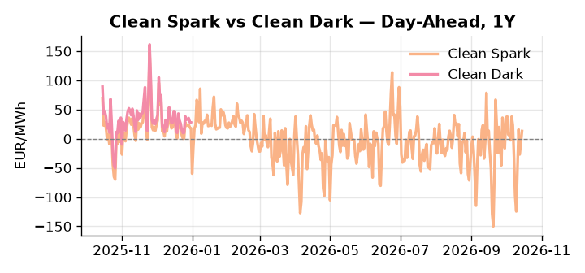
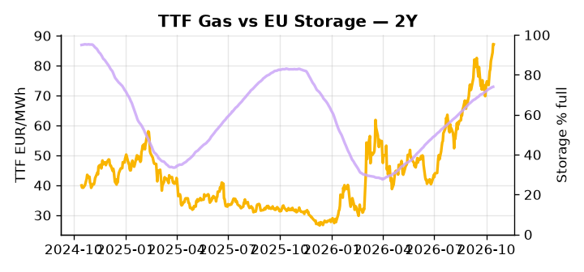

# European Cross-Commodity Risk Pack: Gas + Carbon → Power Curve Implications

**Daily desk brief — 2026-10-15**  
_Author: Sumer Sener · sumerberksener@gmail.com_  
_Generated by `scripts/generate_brief.py`. AI narrative + news themes via Anthropic Claude._

> **Data-freshness caveat:** Clean Dark (last 2025-12-31, 288d old); Coal (last 2025-12-26, 293d old). Numbers below should be read with this in mind.

## 1 · Executive summary

**TL;DR — GB Power at 96th percentile (186.36 EUR/MWh) dominates; storage 14.9pp below seasonal average tilts H2 thermal risk upward; Slovakia-Russia pivot threatens pipeline leverage.**

GB Power at the 96th percentile (186.36 EUR/MWh) is the dominant signal this morning, with EU storage sitting 14.9 percentage points below its five-year seasonal average at 74.02% full, keeping the thermal call structurally extended and leaving little headroom for demand surprises into the winter curve. EUA sits in a bearish-supply posture as the Oct 15–16 EU Leaders Summit carries a methane rule enforcement decision on its agenda — Big Oil lobbying delays risk removing upstream emissions cost on Russian pipeline gas, easing the TTF structural floor and weakening the decarbonisation penalty embedded in the power merit order, a slow-motion drag on EUA long-term support. With coal data 293 days old and clean dark spreads 288 days stale, dark-spread signals are indicative not bankable, and desk should lean on the TTF and power series — both current as of Oct 14–15 — for spread construction. DE Power at the 87th percentile (200 EUR/MWh) confirms systemic thermal tightness across the continent, while Slovakia PM Fico's alignment with Putin escalates transit-hub leverage risk with asymmetric tail exposure to Central and Southern EU supply. With Slovakia-Russia pipeline leverage reasserting as the live geopolitical driver, gas tightness AND a bearish-leaning carbon floor AND stale-but-directionally-supportive clean-dark signals keep front-curve risk wide while the Cal+1 regime remains hostage to summit outcomes on methane enforcement and the Green Deal emergency brake.

_Generated by **claude-sonnet-4-6** via Anthropic API (two-pass extract→narrate). Prompts/responses logged to `ai/logs/`._
_Next-5d temperature anomaly — DE +0.3°C / FR -1.2°C / GB -0.1°C vs 5-yr seasonal normal (Open-Meteo)._

## 2 · Monitor metrics

**Primary (cross-commodity headline tiles)**

| Metric | As of | Latest | Unit | 1d Δ | 1w Δ | 5y pctile | Headline |
|---|---|---:|---|---:|---:|---:|---|
| TTF Gas | 2026-10-14 | 87.14 | EUR/MWh | -0.10% | +11.44% | 81 | Within typical range |
| EU Storage | 2026-10-13 | 74.02 | % full | +0.11% | +1.10% | 61 | 14.9 pp below the 5-yr seasonal average |
| EUA Carbon | 2026-10-14 | 34.14 | EUR/tCO2 | -0.99% | +1.96% | 49 | Within typical range |
| DE Power | 2026-10-15 | 200.00 | EUR/MWh | +11.41% | +29.66% | 87 | Within typical range |
| GB Power | 2026-10-15 | 186.36 | EUR/MWh | -8.75% | +22.84% | 96 | 96th-percentile of 5-yr range — historically high |
| Renewables | 2026-10-14 | 49.23 | % of load | +0.03% | +20.93% | 62 | Within typical range |
| Clean Spark | 2026-10-15 | 13.16 | EUR/MWh | +20.49 | +26.52 | 69 | Within typical range |
| Clean Dark | 2025-12-31 (STALE) | 27.95 | EUR/MWh | -0.56 | +11.63 | 47 | Within typical range |

**Fundamentals inputs** _(feed derived metrics; not separately traded)_

| Metric | As of | Latest | Unit | 1d Δ | 1w Δ | 5y pctile | Headline |
|---|---|---:|---|---:|---:|---:|---|
| Coal | 2025-12-26 (STALE) | 96.00 | USD/t | -0.57% | +0.08% | 8 | 8th-percentile of 5-yr range — historically low |

_Spreads → abs EUR/MWh deltas; others → pct. Weekly Δ uses 5d trailing means. Full history in `data/<metric>.csv`._

## 3 · Gas + LNG arb

**TTF front-month** prints at 87.14 EUR/MWh — _Within typical range_.
**EU storage** at 74.0% full (-14.9 pp vs 5-yr seasonal avg) — _14.9 pp below the 5-yr seasonal average_.
**TTF − JKM (LNG arb)** at +6.79 EUR/MWh (JKM 26.39 USD/MMBtu) — TTF richer than JKM — LNG cargoes favour Europe.

## 4 · Carbon (EU ETS)

**EUA December** prints at 34.14 EUR/tCO2 — _Within typical range_. A euro of EUA adds ~0.37 EUR/MWh to gas-fired and ~0.85 EUR/MWh to coal-fired generation cost; strength compresses the dark spread faster than the spark.

**EU vs UK ETS** — Cobblestone's emissions desk trades EUA and UKA. Post-Brexit auction reform narrowed the UKA discount to EUA from £20+/t to single-digit £/t; CBAM phase-in pulls UK compliance demand toward parity. EUA−UKA basis remains a tradable cross-market signal.

**Supply / policy signal** — _EU leaders summit (Oct 15–16) agenda includes methane rule enforcement decision; Big Oil lobbying delays risk weakening upstream emissions oversight and structural decarbonisation cost._  
Side: `supply` · Polarity: `bearish EUA` · Source: Politico EU Energy

Methane rule delays reduce upstream cost on Russian pipeline gas, easing TTF structural floor and lowering thermal-dispatch decarbonisation penalty — bearish to EUA long-term support and carbon-cost embedded in power merit order.

_Surfaced from today's news flow by the AI extract pass (`ai/prompts/extract_v1.md` → `carbon_policy_signal`)._

## 5 · Power — Day-Ahead & curve

**DE day-ahead baseload** at 200.00 EUR/MWh — _Within typical range_.
**GB day-ahead baseload** at 186.36 EUR/MWh — _96th-percentile of 5-yr range — historically high_.
**DE − GB spread** at +13.64 EUR/MWh (DE premium) — drives interconnector flow direction.
**Cross-border net flows (Power Transportation):** DE↔FR +15.0 GWh (DE export); GB↔FR -7.7 GWh (FR export); NL↔DE -13.4 GWh (DE export).

**Clean spark spread** at +13.16 EUR/MWh — _Within typical range_. Bridge from gas + carbon fundamentals to gas-fired economics; sustained positive spark = TTF moves transmit directly into the power curve.

**Curve shape:** DA → W+1 → M+1 → Q+1 → Cal+1 → Cal+2 = 200 / 157 / 157 / 157 / 157 / 157 EUR/MWh — **Backwardation** (DA −Cal+1 spread +43 EUR/MWh). Forwards are seasonality projections — see Methodology.

{width=49%} {width=49%}

**This week ahead**

- **Fri** 14:30 UTC — EIA weekly natural gas storage report: US storage trajectory anchors LNG export pricing into NW Europe — direct TTF transmission.
- **Thu** 14:30 UTC — US EIA weekly crude inventories: Crude — and via crack spreads, refined-products — feed back into LNG arb economics.
- **Fri** — ENTSO-E weekly day-ahead volumes / system-balance summary: Reads the European generation mix in last 7d — confirms or breaks the Cal+1 thesis.
- **Wed** — EU Leaders Summit (Oct 15–16): Energy prices, methane rules, green subsidy decisions will set policy tone for power cost and carbon regulation through 2026. _(news-extracted)_
- **Thu** — EU Leaders Summit concludes: Outcomes on emergency brake (Germany-Italy) and Green Deal enforcement determine near-term regulatory risk to power spreads and EUA floor. _(news-extracted)_

**Scenarios (1w horizon)**

| | Summary | TTF | DE Power |
|---|---|---:|---:|
| **Base** | GB premium persists; EU storage refill gradual; geopolitical tail risk priced but not shocked. | ±1-3% | ±2-4% |
| **Upside** | Slovakia-Russia pipeline deal signals supply cut or transit leverage; Ukraine refinery campaign lifts Brent crude; thermal call extends. | +8-12% | +6-10% |
| **Downside** | EU summit backs Green Deal; emergency brake stalls; methane rule re-tightened; renewables forecast above 60th percentile softens thermal call. | -5-8% | -4-7% |

_Illustrative, not forecasts. Magnitudes sized off historical sensitivity; AI-generated from today's extract pass._

## 6 · Today's themes

**Weather watch (next 7d)**
- **Storm · GB · Thu 15 – Sun 18 Oct** — peak gust 44 m/s (~157 km/h) on Sat 17 Oct. GB wind capacity is large — DA likely soft. Cut-off risk if gusts exceed safety thresholds; opposite tail (sudden tightening) possible.
- **Storm · FR · Fri 16 – Sat 17 Oct** — peak gust 41 m/s (~148 km/h) on Sat 17 Oct. Strong wind boost to French generation; FR may export to neighbours. DA print likely below seasonal norm; watch FR-GB IFA flow toward GB.

**Watchlist (1–4 weeks)**
- EU leaders summit (Oct 15–16): energy price, methane rule, green subsidy decisions.
- Slovakia–Russia energy negotiations: pipeline transit, supply security terms.

> **Cross-market regime tag:** Tight market: TTF rich vs history while storage runs below seasonal.

_Risk framing — built within a discipline of clear limits and continuous monitoring; observations here are framed as risk inputs, not directional calls. Positioning decisions remain with the desk._
_Methodology + sources: **README §Methodology**. Numbers auditable via the snapshot JSONs. Rule-based / informational — not investment advice._