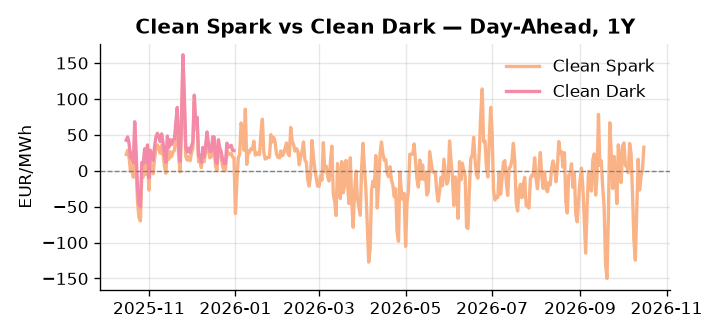
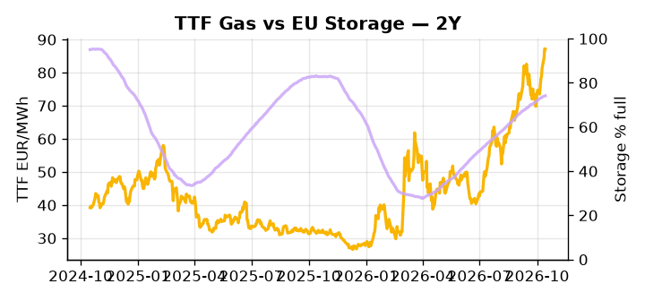

# European Cross-Commodity Risk Pack: Gas + Carbon → Power Curve Implications

**Daily desk brief — 2026-10-16**  
_Author: Sumer Sener · sumerberksener@gmail.com_  
_Generated by `scripts/generate_brief.py`. AI narrative + news themes via Anthropic Claude._

> **Data-freshness caveat:** Clean Dark (last 2025-12-31, 289d old); Coal (last 2025-12-26, 294d old). Numbers below should be read with this in mind.

## 1 · Executive summary

**TL;DR — GB Power at 99th percentile amid tight renewables; Storage 14.8pp below seasonal drives winter risk premium; geopolitical uncertainty (Slovakia–Russia, Ukraine strikes) supports TTF floor.**

GB Power at the 99th percentile (222.24 EUR/MWh) with renewables supplying just 39.58% of load — a 40th-percentile reading after a 19.6% single-day collapse — is the dominant signal: structural thermal tightness is forcing extended gas, coal, and nuclear dispatch with no near-term wind relief in sight. EU storage sitting 14.8 percentage points below its five-year seasonal norm at 74.14% full means the refill trajectory into winter is now the critical TTF anchor, and any pace deceleration reprices the front-month materially higher. With coal data 294 days old and Clean Dark and Clean Spark spreads 289 days stale, the Clean Spark reading of 32.64 EUR/MWh (89th percentile, a 13.6-sigma daily move) is indicative not bankable — live DA cross-check is required before trading derived spreads. EUA demand sits on a structurally bullish policy footing as Von der Leyen's strategic gas reserves proposal — signalling EU willingness to burn coal and gasoil under supply stress — extends coal run-time and widens the merit order, raising absolute compliance need as a slow-motion supply tightening takes hold. With Slovakia–Russia rapprochement threatening to constrain or reroute pipeline transit flows, gas tightness AND EUA bullish-policy pressure AND a Clean Spark extended at the 89th percentile keep the front-curve risk regime wide, while the Cal+1 regime hinges on whether the geopolitical trigger activates or remains priced-but-latent.

_Generated by **claude-sonnet-4-6** via Anthropic API (two-pass extract→narrate). Prompts/responses logged to `ai/logs/`._
_Next-5d temperature anomaly — DE -0.0°C / FR -2.3°C / GB -1.2°C vs 5-yr seasonal normal (Open-Meteo)._

## 2 · Monitor metrics

**Primary (cross-commodity headline tiles)**

| Metric | As of | Latest | Unit | 1d Δ | 1w Δ | 5y pctile | Headline |
|---|---|---:|---|---:|---:|---:|---|
| TTF Gas | 2026-10-14 | 87.14 | EUR/MWh | -0.10% | +11.44% | 81 | Within typical range |
| EU Storage | 2026-10-14 | 74.14 | % full | +0.12% | +1.10% | 61 | 14.8 pp below the 5-yr seasonal average |
| EUA Carbon | 2026-10-15 | 33.80 | EUR/tCO2 | -1.00% | +1.58% | 46 | Within typical range |
| DE Power | 2026-10-16 | 219.35 | EUR/MWh | +17.19% | +61.65% | 89 | Within typical range |
| GB Power | 2026-10-16 | 222.24 | EUR/MWh | -2.42% | +40.21% | 99 | 99th-percentile of 5-yr range — historically high |
| Renewables | 2026-10-15 | 39.58 | % of load | -19.60% | -15.71% | 40 | Within typical range |
| Clean Spark | 2026-10-16 | 32.64 | EUR/MWh | +32.18 | +59.26 | 89 | outsized daily move (+7088.14%, 13.6σ) |
| Clean Dark | 2025-12-31 (STALE) | 27.95 | EUR/MWh | -0.56 | +11.63 | 47 | Within typical range |

**Fundamentals inputs** _(feed derived metrics; not separately traded)_

| Metric | As of | Latest | Unit | 1d Δ | 1w Δ | 5y pctile | Headline |
|---|---|---:|---|---:|---:|---:|---|
| Coal | 2025-12-26 (STALE) | 96.00 | USD/t | -0.57% | +0.08% | 8 | 8th-percentile of 5-yr range — historically low |

_Spreads → abs EUR/MWh deltas; others → pct. Weekly Δ uses 5d trailing means. Full history in `data/<metric>.csv`._

## 3 · Gas + LNG arb

**TTF front-month** prints at 87.14 EUR/MWh — _Within typical range_.
**EU storage** at 74.1% full (-14.8 pp vs 5-yr seasonal avg) — _14.8 pp below the 5-yr seasonal average_.
**TTF − JKM (LNG arb)** at +6.72 EUR/MWh (JKM 26.39 USD/MMBtu) — TTF richer than JKM — LNG cargoes favour Europe.

## 4 · Carbon (EU ETS)

**EUA December** prints at 33.80 EUR/tCO2 — _Within typical range_. A euro of EUA adds ~0.37 EUR/MWh to gas-fired and ~0.85 EUR/MWh to coal-fired generation cost; strength compresses the dark spread faster than the spark.

**EU vs UK ETS** — Cobblestone's emissions desk trades EUA and UKA. Post-Brexit auction reform narrowed the UKA discount to EUA from £20+/t to single-digit £/t; CBAM phase-in pulls UK compliance demand toward parity. EUA−UKA basis remains a tradable cross-market signal.

**Supply / policy signal** — _Von der Leyen EU strategic gas reserves proposal signals acceptance of winter supply shortfall; implies higher dispatch of coal and LNG if gas constrained, raising EUA demand via merit-order widening and extended coal marginal rate._  
Side: `policy` · Polarity: `bullish EUA` · Source: Politico EU Energy

Strategic reserves move telegraphs EU willingness to burn higher-carbon fuels (coal, gasoil) if gas supply disrupted; shifts merit order and extends coal run-time, raising absolute emissions and EUA compliance need.

_Surfaced from today's news flow by the AI extract pass (`ai/prompts/extract_v1.md` → `carbon_policy_signal`)._

## 5 · Power — Day-Ahead & curve

**DE day-ahead baseload** at 219.35 EUR/MWh — _Within typical range_.
**GB day-ahead baseload** at 222.24 EUR/MWh — _99th-percentile of 5-yr range — historically high_.
**DE − GB spread** at -2.89 EUR/MWh (GB premium) — drives interconnector flow direction.
**Cross-border net flows (Power Transportation):** DE↔FR -27.2 GWh (FR export); GB↔FR -14.3 GWh (FR export); NL↔DE +34.7 GWh (NL export).

**Clean spark spread** at +32.64 EUR/MWh — _outsized daily move (+7088.14%, 13.6σ)_. Bridge from gas + carbon fundamentals to gas-fired economics; sustained positive spark = TTF moves transmit directly into the power curve.

**Curve shape:** DA → W+1 → M+1 → Q+1 → Cal+1 → Cal+2 = 219 / 161 / 161 / 161 / 161 / 161 EUR/MWh — **Backwardation** (DA −Cal+1 spread +58 EUR/MWh). Forwards are seasonality projections — see Methodology.

{width=49%} {width=49%}

**This week ahead**

- **Fri** 14:30 UTC — EIA weekly natural gas storage report: US storage trajectory anchors LNG export pricing into NW Europe — direct TTF transmission.
- **Fri** — ENTSO-E weekly day-ahead volumes / system-balance summary: Reads the European generation mix in last 7d — confirms or breaks the Cal+1 thesis.
- **Tue** 08:00 UTC — AGSI+ daily storage print: First read on the week's gas injection / withdrawal pace; sets the tone for TTF curve shape.
- **Thu** — EU Council energy consensus vote: Strategic gas reserves & price intervention policy clarity; sets tone for TTF floor and member-state fiscal support. _(news-extracted)_

**Scenarios (24-72h horizon)**

| | Summary | TTF | DE Power |
|---|---|---:|---:|
| **Base** | Renewables stabilize mid-range; storage refill continues at trend; geopolitical risk priced but not activated. | ±1-3% | tracks |
| **Upside** | Slovakia gas transit threatened or Russian reroute confirmed; Ukraine refinery strikes spike crude; EU consensus delays. | +8-15% | +12-18% |
| **Downside** | Wind recovery lifts renewables to 55th+ percentile; storage refill accelerates; EU fiscal intervention announced. | -5-10% | -10-15% |

_Illustrative, not forecasts. Magnitudes sized off historical sensitivity; AI-generated from today's extract pass._

## 6 · Today's themes

**Weather watch (next 7d)**
- **Storm · FR · Fri 16 – Sun 18 Oct** — peak gust 36 m/s (~128 km/h) on Sat 17 Oct. Strong wind boost to French generation; FR may export to neighbours. DA print likely below seasonal norm; watch FR-GB IFA flow toward GB.
- **Cold snap · FR · Sun 18 – Mon 19 Oct** — peak -6.3°C vs normal. Strongly bullish FR power — French electric heating means a 1°C temperature drop adds ~2 GW of demand. FR DA spikes, IFA imports surge.

**Watchlist (1–4 weeks)**
- EU Council consensus on winter energy price policy and strategic reserves deployment (days).
- Slovakia–Russia energy & transit negotiations; any signals on gas flow commitments (weeks).

> **Cross-market regime tag:** Tight market: TTF rich vs history while storage runs below seasonal.

_Risk framing — built within a discipline of clear limits and continuous monitoring; observations here are framed as risk inputs, not directional calls. Positioning decisions remain with the desk._
_Methodology + sources: **README §Methodology**. Numbers auditable via the snapshot JSONs. Rule-based / informational — not investment advice._