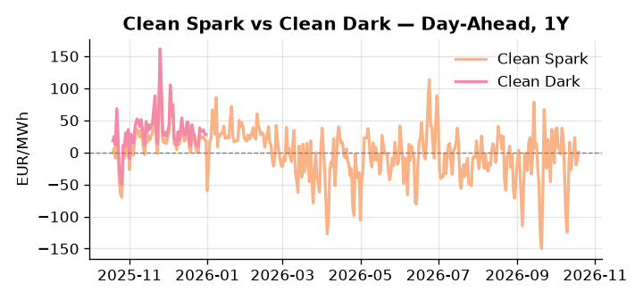
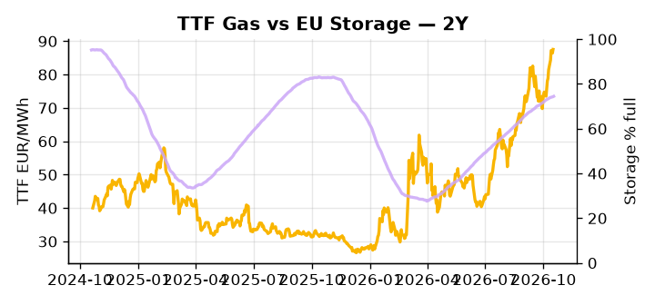

# European Cross-Commodity Risk Pack: Gas + Carbon → Power Curve Implications

**Daily desk brief — 2026-10-19**  
_Author: Sumer Sener · sumerberksener@gmail.com_  
_Generated by `scripts/generate_brief.py`. AI narrative + news themes via Anthropic Claude._

> **Data-freshness caveat:** Clean Dark (last 2025-12-31, 292d old); Coal (last 2025-12-26, 297d old). Numbers below should be read with this in mind.

## 1 · Executive summary

**TL;DR — GB Power at 98th-percentile, EU storage 14.6 pp below seasonal; Slovakia-Russia rapprochement and strategic reserve proposals create winter supply tail-risk.**

GB Power at 204.74 EUR/MWh — 98th-percentile, up 24.93% on the week — is the dominant signal, pointing to acute supply-side stress or a sustained cold bias driving structural tightness in the front curve. EU storage sitting 14.6 percentage points below seasonal baseline at 74.47% full compounds the picture, with refill pace into winter the critical variable for thermal dispatch economics and TTF risk premium sustainability. Slovakia-Russia rapprochement under PM Fico introduces a live transit-disruption tail that keeps the upside scenario firmly on the table, while Von der Leyen's strategic reserve proposal injects countervailing policy uncertainty that is bearish-power if adopted but faces fragmented member-state consensus, with Monday's EU Council energy price vote the nearest catalyst. With coal, clean-dark, and clean-spark data between 292 and 297 days old, spread levels are indicative not bankable — live power and gas signals carry the dispatch weight here. Slovakia-Russia transit risk pulling front-curve risk wider, storage-driven gas tightness anchoring TTF risk premium, and clean-spread headroom compressed by stale coal data collectively define a front-curve stress regime with Cal+1 contingent on refill trajectory and Fico-flow resolution.

_Generated by **claude-sonnet-4-6** via Anthropic API (two-pass extract→narrate). Prompts/responses logged to `ai/logs/`._
_Next-5d temperature anomaly — DE -1.0°C / FR -2.3°C / GB -1.4°C vs 5-yr seasonal normal (Open-Meteo)._

## 2 · Monitor metrics

**Primary (cross-commodity headline tiles)**

| Metric | As of | Latest | Unit | 1d Δ | 1w Δ | 5y pctile | Headline |
|---|---|---:|---|---:|---:|---:|---|
| TTF Gas | 2026-10-16 | 87.55 | EUR/MWh | +1.29% | +11.64% | 81 | Within typical range |
| EU Storage | 2026-10-17 | 74.47 | % full | +0.22% | +0.79% | 62 | 14.6 pp below the 5-yr seasonal average |
| EUA Carbon | 2026-10-16 | 33.60 | EUR/tCO2 | -0.59% | +0.65% | 43 | Within typical range |
| DE Power | 2026-10-19 | 187.79 | EUR/MWh | +7.04% | +30.94% | 85 | Within typical range |
| GB Power | 2026-10-19 | 204.74 | EUR/MWh | +7.80% | +24.93% | 98 | 98th-percentile of 5-yr range — historically high |
| Renewables | 2026-10-18 | 54.93 | % of load | +7.89% | -27.97% | 73 | Within typical range |
| Clean Spark | 2026-10-19 | 0.33 | EUR/MWh | +12.35 | +38.14 | 50 | Within typical range |
| Clean Dark | 2025-12-31 (STALE) | 27.95 | EUR/MWh | -0.56 | +11.63 | 47 | Within typical range |

**Fundamentals inputs** _(feed derived metrics; not separately traded)_

| Metric | As of | Latest | Unit | 1d Δ | 1w Δ | 5y pctile | Headline |
|---|---|---:|---|---:|---:|---:|---|
| Coal | 2025-12-26 (STALE) | 96.00 | USD/t | -0.57% | +0.08% | 8 | 8th-percentile of 5-yr range — historically low |

_Spreads → abs EUR/MWh deltas; others → pct. Weekly Δ uses 5d trailing means. Full history in `data/<metric>.csv`._

## 3 · Gas + LNG arb

**TTF front-month** prints at 87.55 EUR/MWh — _Within typical range_.
**EU storage** at 74.5% full (-14.6 pp vs 5-yr seasonal avg) — _14.6 pp below the 5-yr seasonal average_.
**TTF − JKM (LNG arb)** at -3.51 EUR/MWh (JKM 29.92 USD/MMBtu) — JKM richer than TTF — Asia pulls cargoes, marginal European tightening risk.

## 4 · Carbon (EU ETS)

**EUA December** prints at 33.60 EUR/tCO2 — _Within typical range_. A euro of EUA adds ~0.37 EUR/MWh to gas-fired and ~0.85 EUR/MWh to coal-fired generation cost; strength compresses the dark spread faster than the spark.

**EU vs UK ETS** — Cobblestone's emissions desk trades EUA and UKA. Post-Brexit auction reform narrowed the UKA discount to EUA from £20+/t to single-digit £/t; CBAM phase-in pulls UK compliance demand toward parity. EUA−UKA basis remains a tradable cross-market signal.

**Supply / policy signal** — _CBAM full operational phase live since 1 Jan 2026 — importers paying for embedded emissions_  
Side: `policy` · Polarity: `bullish EUA` · Source: EU Regulation 2023/956 (CBAM)

Domestic carbon-cost burden gradually levelled with imports; supports EUA demand floor as carbon leakage protection tightens through 2034.

_No ETS-relevant news surfaced today — falling back to `data/policy_facts.py` (hand-maintained structural fact pack). Fact pack last reviewed 2026-05-08 (164d ago)._

## 5 · Power — Day-Ahead & curve

**DE day-ahead baseload** at 187.79 EUR/MWh — _Within typical range_.
**GB day-ahead baseload** at 204.74 EUR/MWh — _98th-percentile of 5-yr range — historically high_.
**DE − GB spread** at -16.95 EUR/MWh (GB premium) — drives interconnector flow direction.
**Cross-border net flows (Power Transportation):** DE↔FR -14.8 GWh (FR export); GB↔FR -53.0 GWh (FR export); NL↔DE -53.0 GWh (DE export).

**Clean spark spread** at +0.33 EUR/MWh — _Within typical range_. Bridge from gas + carbon fundamentals to gas-fired economics; sustained positive spark = TTF moves transmit directly into the power curve.

**Curve shape:** DA → W+1 → M+1 → Q+1 → Cal+1 → Cal+2 = 188 / 165 / 165 / 165 / 165 / 165 EUR/MWh — **Backwardation** (DA −Cal+1 spread +23 EUR/MWh). Forwards are seasonality projections — see Methodology.

{width=49%} {width=49%}

**This week ahead**

- **Tue** 08:00 UTC — AGSI+ daily storage print: First read on the week's gas injection / withdrawal pace; sets the tone for TTF curve shape.
- **Wed** 09:00 UTC — EEX EUA primary auction (Mon–Thu daily; Wed is largest volume): Supply-side EUA signal; auction clearing relative to spot reads as ETS demand strength.
- **Wed** — ENTSO-E DE_LU + GB next-week wind/solar forecast refresh: Sets the residual-load curve a week out; outsized prints move power Cal+1 directionally.
- **Mon** — EU Council energy price vote outcome: Member state consensus on price intervention and strategic reserves will shape winter policy regime and TTF forward expectations. _(news-extracted)_

**Scenarios (24-72h | 1w horizon)**

| | Summary | TTF | DE Power |
|---|---|---:|---:|
| **Base** | GB premium holds; storage refill steady; TTF tracks seasonal tightness; policy uncertainty sustains mild bid. | +1-3% | ±1-2% |
| **Upside** | Slovakia-Russia deal disrupts transit flows or cold weather extends demand; storage refill slows. TTF rallies on supply tail-risk. | +8-15% | +5-12% |
| **Downside** | Von der Leyen strategic reserve proposal gains member state traction; mild weather and storage builds accelerate; demand softens. | -5-10% | -8-15% |

_Illustrative, not forecasts. Magnitudes sized off historical sensitivity; AI-generated from today's extract pass._

## 6 · Today's themes

**Weather watch (next 7d)**
- **Storm · GB · Tue 20 – Sun 25 Oct** — peak gust 78 m/s (~280 km/h) on Fri 23 Oct. GB wind capacity is large — DA likely soft. Cut-off risk if gusts exceed safety thresholds; opposite tail (sudden tightening) possible.
- **Storm · FR · Wed 21 – Sun 25 Oct** — peak gust 82 m/s (~294 km/h) on Sun 25 Oct. Strong wind boost to French generation; FR may export to neighbours. DA print likely below seasonal norm; watch FR-GB IFA flow toward GB.

**Watchlist (1–4 weeks)**
- EU Council energy price and budget vote outcome over next 2 weeks.
- Von der Leyen strategic gas reserve proposal adoption timeline and member state buy-in.

> **Cross-market regime tag:** Tight market: TTF rich vs history while storage runs below seasonal.

_Risk framing — built within a discipline of clear limits and continuous monitoring; observations here are framed as risk inputs, not directional calls. Positioning decisions remain with the desk._
_Methodology + sources: **README §Methodology**. Numbers auditable via the snapshot JSONs. Rule-based / informational — not investment advice._