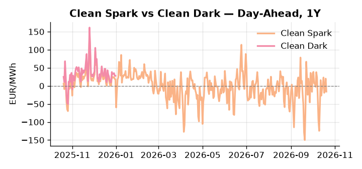
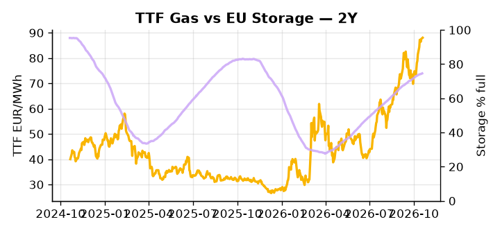

# European Cross-Commodity Risk Pack: Gas + Carbon → Power Curve Implications

**Daily desk brief — 2026-10-20**  
_Author: Sumer Sener · sumerberksener@gmail.com_  
_Generated by `scripts/generate_brief.py`. AI narrative + news themes via Anthropic Claude._

> **Data-freshness caveat:** Clean Dark (last 2025-12-31, 293d old); Coal (last 2025-12-26, 298d old). Numbers below should be read with this in mind.

## 1 · Executive summary

**TL;DR — GB Power at 90th-percentile amid storage 14.6 pp below seasonal norm; geopolitical LNG risk (Slovakia-Russia ties) and EU strategic reserve push create winter supply tail risk.**

GB Power has printed at 169.49 EUR/MWh (90th-percentile) and DE Power at 172.73 EUR/MWh (83rd-percentile), with storage sitting 14.6 percentage points below the five-year seasonal norm at 74.58% — twin thermal regimes confirming that scarcity is the dominant regime entering winter, not a local spike. The Slovakia-Fico-Putin alignment adds a live LNG supply-chain disruption tail that keeps TTF-HH spread widening risk on the table alongside the EU strategic reserve proposal, creating competing signals between supply-stabilization policy and import-flexibility erosion. EUA forward pricing is anchored in the mid-range as the France-Germany compromise on car emissions and Made-in-Europe sourcing removes the near-term legislative roadblock to ETS-2 transport expansion from 2027, signalling climate-policy continuity and reducing curve volatility on the carbon side. With coal and clean dark data 298 and 293 days stale respectively, the dark spread is indicative not bankable and fossil merit-order signals should not be carried into live dispatch analysis today. With Slovakia-Russia LNG disruption tail risk reasserting, gas tightness pulls front-curve risk wider while EUA stabilisation and an elevated but compressed clean-spark differential keep the Cal+1 regime anchored in a thermal-scarcity, policy-supported configuration.

_Generated by **claude-sonnet-4-6** via Anthropic API (two-pass extract→narrate). Prompts/responses logged to `ai/logs/`._
_Next-5d temperature anomaly — DE -0.7°C / FR -2.4°C vs 5-yr seasonal normal (Open-Meteo)._

## 2 · Monitor metrics

**Primary (cross-commodity headline tiles)**

| Metric | As of | Latest | Unit | 1d Δ | 1w Δ | 5y pctile | Headline |
|---|---|---:|---|---:|---:|---:|---|
| TTF Gas | 2026-10-19 | 88.04 | EUR/MWh | +0.56% | +9.53% | 81 | Within typical range |
| EU Storage | 2026-10-18 | 74.58 | % full | +0.15% | +0.73% | 62 | 14.6 pp below the 5-yr seasonal average |
| EUA Carbon | 2026-10-19 | 33.93 | EUR/tCO2 | +0.97% | -0.11% | 47 | Within typical range |
| DE Power | 2026-10-20 | 172.73 | EUR/MWh | -17.22% | +10.57% | 83 | Within typical range |
| GB Power | 2026-10-20 | 169.49 | EUR/MWh | -21.47% | +2.39% | 90 | 90th-percentile of 5-yr range — historically high |
| Renewables | 2026-10-19 | 55.58 | % of load | +1.19% | -17.85% | 74 | Within typical range |
| Clean Spark | 2026-10-20 | -15.84 | EUR/MWh | -35.92 | +17.20 | 34 | Within typical range |
| Clean Dark | 2025-12-31 (STALE) | 27.80 | EUR/MWh | -0.56 | +11.51 | 47 | Within typical range |

**Fundamentals inputs** _(feed derived metrics; not separately traded)_

| Metric | As of | Latest | Unit | 1d Δ | 1w Δ | 5y pctile | Headline |
|---|---|---:|---|---:|---:|---:|---|
| Coal | 2025-12-26 (STALE) | 96.48 | USD/t | -0.07% | +0.18% | 9 | 9th-percentile of 5-yr range — historically low |

_Spreads → abs EUR/MWh deltas; others → pct. Weekly Δ uses 5d trailing means. Full history in `data/<metric>.csv`._

## 3 · Gas + LNG arb

**TTF front-month** prints at 88.04 EUR/MWh — _Within typical range_.
**EU storage** at 74.6% full (-14.6 pp vs 5-yr seasonal avg) — _14.6 pp below the 5-yr seasonal average_.
**TTF − JKM (LNG arb)** at -3.18 EUR/MWh (JKM 30.01 USD/MMBtu) — JKM richer than TTF — Asia pulls cargoes, marginal European tightening risk.

## 4 · Carbon (EU ETS)

**EUA December** prints at 33.93 EUR/tCO2 — _Within typical range_. A euro of EUA adds ~0.37 EUR/MWh to gas-fired and ~0.85 EUR/MWh to coal-fired generation cost; strength compresses the dark spread faster than the spark.

**EU vs UK ETS** — Cobblestone's emissions desk trades EUA and UKA. Post-Brexit auction reform narrowed the UKA discount to EUA from £20+/t to single-digit £/t; CBAM phase-in pulls UK compliance demand toward parity. EUA−UKA basis remains a tradable cross-market signal.

**Supply / policy signal** — _France-Germany strike compromise on car emissions and Made-in-Europe sourcing; removes roadblock to ETS-linked transport carbon rules._  
Side: `policy` · Polarity: `neutral` · Source: Politico EU Energy

Resolves near-term legislative risk for ETS-2 (transport expansion from 2027); signals climate policy continuity and reduces curve volatility; stabilizes EUA forward pricing.

_Surfaced from today's news flow by the AI extract pass (`ai/prompts/extract_v1.md` → `carbon_policy_signal`)._

## 5 · Power — Day-Ahead & curve

**DE day-ahead baseload** at 172.73 EUR/MWh — _Within typical range_.
**GB day-ahead baseload** at 169.49 EUR/MWh — _90th-percentile of 5-yr range — historically high_.
**DE − GB spread** at +3.24 EUR/MWh (DE premium) — drives interconnector flow direction.
**Cross-border net flows (Power Transportation):** DE↔FR +4.2 GWh (DE export); GB↔FR +1.5 GWh (GB export); NL↔DE -8.6 GWh (DE export).

**Clean spark spread** at -15.84 EUR/MWh — _Within typical range_. Bridge from gas + carbon fundamentals to gas-fired economics; sustained positive spark = TTF moves transmit directly into the power curve.

**Curve shape:** DA → W+1 → M+1 → Q+1 → Cal+1 → Cal+2 = 173 / 166 / 166 / 166 / 166 / 166 EUR/MWh — **Backwardation** (DA −Cal+1 spread +7 EUR/MWh). Forwards are seasonality projections — see Methodology.

{width=49%} {width=49%}

**This week ahead**

- **Tue** 08:00 UTC — AGSI+ daily storage print: First read on the week's gas injection / withdrawal pace; sets the tone for TTF curve shape.
- **Wed** 09:00 UTC — EEX EUA primary auction (Mon–Thu daily; Wed is largest volume): Supply-side EUA signal; auction clearing relative to spot reads as ETS demand strength.
- **Wed** — ENTSO-E DE_LU + GB next-week wind/solar forecast refresh: Sets the residual-load curve a week out; outsized prints move power Cal+1 directionally.
- **Nov** — EU strategic reserve framework rollout timeline: Policy implementation pace shapes winter gas availability and forward TTF curve stability. _(news-extracted)_

**Scenarios (1w horizon)**

| | Summary | TTF | DE Power |
|---|---|---:|---:|
| **Base** | Storage refill moderate; EU reserve framework shapes Q4 gas demand; power held elevated by thermal scarcity. | ±2-4% | ±3-5% |
| **Upside** | Slovakia LNG supply disruption or cold front accelerates; EU emergency gas purchases; power spreads widen. | +8-15% | +12-18% |
| **Downside** | EU reserve framework announced with credible supply commitment; weather mild; renewable share surge lifts gas substitution. | -6-10% | -8-12% |

_Illustrative, not forecasts. Magnitudes sized off historical sensitivity; AI-generated from today's extract pass._

## 6 · Today's themes

**Weather watch (next 7d)**
- **Storm · FR · Tue 20 – Mon 26 Oct** — peak gust 62 m/s (~222 km/h) on Fri 23 Oct. Strong wind boost to French generation; FR may export to neighbours. DA print likely below seasonal norm; watch FR-GB IFA flow toward GB.
- **Storm · DE · Thu 22 Oct** — peak gust 36 m/s (~130 km/h) on Thu 22 Oct. Wind generation likely surges Day 1, then risk of turbine cut-off if gusts exceed 25 m/s. Bearish DA early, sharp reversal possible. Watch DE-FR flow swings.

**Watchlist (1–4 weeks)**
- EU winter gas supply updates and strategic reserve framework rollout (Nov–Dec).
- Slovakia energy policy shifts under Fico; LNG contract renegotiation risk.

> **Cross-market regime tag:** Tight market: TTF rich vs history while storage runs below seasonal.

_Risk framing — built within a discipline of clear limits and continuous monitoring; observations here are framed as risk inputs, not directional calls. Positioning decisions remain with the desk._
_Methodology + sources: **README §Methodology**. Numbers auditable via the snapshot JSONs. Rule-based / informational — not investment advice._