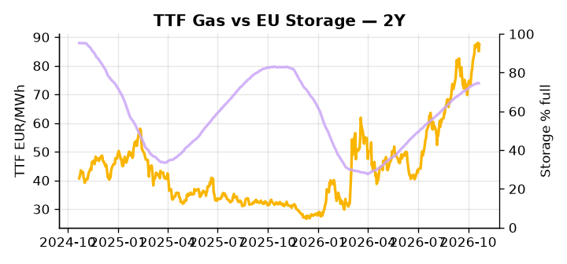

# European Cross-Commodity Risk Pack: Gas + Carbon → Power Curve Implications

**Daily desk brief — 2026-10-22**  
_Author: Sumer Sener · sumerberksener@gmail.com_  
_Generated by `scripts/generate_brief.py`. AI narrative + news themes via Anthropic Claude._

> **Data-freshness caveat:** Coal (last 2025-12-26, 300d old). Numbers below should be read with this in mind.

## 1 · Executive summary

**TL;DR — TTF at 81st-percentile (+19% M/M) backstopped by sanctions hold and UK emergency imports; coal at 8th-percentile (stale) creates massive dark-spread skew; storage 14.7pp below seasonal average supports winter premium.**

TTF is the dominant signal: sitting at the 81st percentile after a +19% month-on-month move, it is backstopped by a locked sanctions regime and UK emergency gas imports from the Continent, confirming NW European balances are structurally tight heading into winter. Storage at 74.58% full — 14.7 percentage points below seasonal average — removes the usual buffer against LNG disruption, keeping the winter premium extended and the refill race into November–December the primary lever for the Q4–Q1 power curve. EUA sits in mid-range but faces explicit bearish policy pressure as the EPP pushes to weaken ETS scope and cap carbon pricing on heating and transport, a slow-motion erosion of the fuel-switch floor that directly compresses gas demand at the margin of the thermal merit order. Coal at the 8th percentile nominally sets up massive dark-spread skew, but with coal data 300 days old as of 2025-12-26, that dark spread is indicative not bankable — a fresh read is essential before sizing any thermal hedge. With AfD and National Rally coalition pressure on Russian sanctions reasserting itself as a tail-risk, gas tightness at the 81st percentile AND EUA floor headroom compressed by EPP policy fracture AND dark spreads structurally in-the-money but unconfirmed keep the front-curve regime anchored to LNG dependency risk while Cal+1 certainty erodes with every carbon policy headline.

_Generated by **claude-sonnet-4-6** via Anthropic API (two-pass extract→narrate). Prompts/responses logged to `ai/logs/`._
_Next-5d temperature anomaly — DE -0.6°C / FR -0.9°C vs 5-yr seasonal normal (Open-Meteo)._

## 2 · Monitor metrics

**Primary (cross-commodity headline tiles)**

| Metric | As of | Latest | Unit | 1d Δ | 1w Δ | 5y pctile | Headline |
|---|---|---:|---|---:|---:|---:|---|
| TTF Gas | 2026-10-21 | 87.43 | EUR/MWh | +2.78% | +3.70% | 81 | Within typical range |
| EU Storage | 2026-10-20 | 74.58 | % full | -0.05% | +0.62% | 62 | 14.7 pp below the 5-yr seasonal average |
| EUA Carbon | 2026-10-21 | 34.01 | EUR/tCO2 | -0.22% | -1.07% | 48 | Within typical range |
| DE Power | — | — | EUR/MWh | — | — | — | (no data) |
| GB Power | 2026-10-22 | 125.50 | EUR/MWh | -37.14% | -5.73% | 64 | Within typical range |
| Renewables | — | — | % of load | — | — | — | (no data) |
| Clean Spark | — | — | EUR/MWh | — | — | — | (no data) |
| Clean Dark | — | — | EUR/MWh | — | — | — | (no data) |

**Fundamentals inputs** _(feed derived metrics; not separately traded)_

| Metric | As of | Latest | Unit | 1d Δ | 1w Δ | 5y pctile | Headline |
|---|---|---:|---|---:|---:|---:|---|
| Coal | 2025-12-26 (STALE) | 96.00 | USD/t | -0.57% | +0.08% | 8 | 8th-percentile of 5-yr range — historically low |

_Spreads → abs EUR/MWh deltas; others → pct. Weekly Δ uses 5d trailing means. Full history in `data/<metric>.csv`._

## 3 · Gas + LNG arb

**TTF front-month** prints at 87.43 EUR/MWh — _Within typical range_.
**EU storage** at 74.6% full (-14.7 pp vs 5-yr seasonal avg) — _14.7 pp below the 5-yr seasonal average_.
**TTF − JKM (LNG arb)** at -3.94 EUR/MWh (JKM 30.06 USD/MMBtu) — JKM richer than TTF — Asia pulls cargoes, marginal European tightening risk.

## 4 · Carbon (EU ETS)

**EUA December** prints at 34.01 EUR/tCO2 — _Within typical range_. A euro of EUA adds ~0.37 EUR/MWh to gas-fired and ~0.85 EUR/MWh to coal-fired generation cost; strength compresses the dark spread faster than the spark.

**EU vs UK ETS** — Cobblestone's emissions desk trades EUA and UKA. Post-Brexit auction reform narrowed the UKA discount to EUA from £20+/t to single-digit £/t; CBAM phase-in pulls UK compliance demand toward parity. EUA−UKA basis remains a tradable cross-market signal.

**Supply / policy signal** — _EU conservatives (EPP) target carbon price on heating and driving, methane rules weakening; ETS scope expansion under political pressure._  
Side: `policy` · Polarity: `bearish EUA` · Source: Politico EU Energy

Weakening EUA floor reduces fuel-switching incentive from coal to gas in power merit order; direct hit to thermal dispatch economics and gas demand at margin.

_Surfaced from today's news flow by the AI extract pass (`ai/prompts/extract_v1.md` → `carbon_policy_signal`)._

## 5 · Power — Day-Ahead & curve

**GB day-ahead baseload** at 125.50 EUR/MWh — _Within typical range_.

**This week ahead**

- **Fri** 14:30 UTC — EIA weekly natural gas storage report: US storage trajectory anchors LNG export pricing into NW Europe — direct TTF transmission.
- **Thu** 14:30 UTC — US EIA weekly crude inventories: Crude — and via crack spreads, refined-products — feed back into LNG arb economics.
- **Fri** — ENTSO-E weekly day-ahead volumes / system-balance summary: Reads the European generation mix in last 7d — confirms or breaks the Cal+1 thesis.
- **Mon** — EU Council climate vote (if scheduled this week): ETS scope revision outcome feeds directly into EUA floor and gas switch economics. _(news-extracted)_

**Scenarios (24-72h | 1w horizon)**

| | Summary | TTF | DE Power |
|---|---|---:|---:|
| **Base** | TTF holds 81st-percentile on sanctions certainty, UK imports steady, storage refill modest; EUA stable mid-range; no shocks. | +1 to +3% | tracks |
| **Upside** | Winter weather tightens (early cold snap); LNG delays or supply disruption (refinery outage, shipping); storage refill stalls below 60%. TTF spikes. | +8 to +15% | +12 to +18% |
| **Downside** | EU political fracture on sanctions escalates (coalition talks signal Russian gas re-entry); carbon reform weakens ETS floor; thermal merit order collapses. | -6 to -12% | -8 to -14% |

_Illustrative, not forecasts. Magnitudes sized off historical sensitivity; AI-generated from today's extract pass._

## 6 · Today's themes

**Weather watch (next 7d)**
- **Storm · DE · Thu 22 – Mon 26 Oct** — peak gust 54 m/s (~193 km/h) on Sun 25 Oct. Wind generation likely surges Day 1, then risk of turbine cut-off if gusts exceed 25 m/s. Bearish DA early, sharp reversal possible. Watch DE-FR flow swings.
- **Storm · FR · Thu 22 – Wed 28 Oct** — peak gust 73 m/s (~262 km/h) on Fri 23 Oct. Strong wind boost to French generation; FR may export to neighbours. DA print likely below seasonal norm; watch FR-GB IFA flow toward GB.

**Watchlist (1–4 weeks)**
- UK-EU energy reset negotiations post-summit; monitor gas pipeline agreements.
- EU Council votes on climate/ETS scope revision; EPP dominance may delay EUA cap enforcement.

> **Cross-market regime tag:** Tight market: TTF rich vs history while storage runs below seasonal.

_Risk framing — built within a discipline of clear limits and continuous monitoring; observations here are framed as risk inputs, not directional calls. Positioning decisions remain with the desk._
_Methodology + sources: **README §Methodology**. Numbers auditable via the snapshot JSONs. Rule-based / informational — not investment advice._