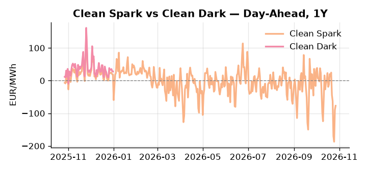
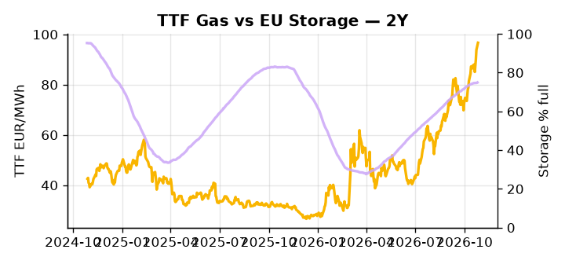

# European Cross-Commodity Risk Pack: Gas + Carbon → Power Curve Implications

**Daily desk brief — 2026-10-27**  
_Author: Sumer Sener · sumerberksener@gmail.com_  
_Generated by `scripts/generate_brief.py`. AI narrative + news themes via Anthropic Claude._

> **Data-freshness caveat:** Clean Dark (last 2025-12-31, 300d old); Coal (last 2025-12-26, 305d old). Numbers below should be read with this in mind.

## 1 · Executive summary

**TL;DR — GB Power at 1st percentile; renewables at 95th; TTF extended 2.4σ high on policy fragmentation and U.S. refining tightness—fuel switch regime broken by oversupply despite winter risk.**

GB Power collapsed to the 1st percentile at 41.96 EUR/MWh as renewables hit 95th-percentile oversupply, breaking the fuel-switch signal and pushing Clean Spark deep out-of-the-money at the 9th percentile (–77 EUR/MWh), with CCGT call-on effectively near zero. TTF remains extended 2.4σ above its 50-day trend at 96.68 EUR/MWh, anchored by U.S. refinery utilisation at its highest since 1998 constraining Atlantic arbitrage inflows and compressing the EU supply substitute window. EUA sits at the 53rd percentile (34.68 EUR/t) in neutral mid-range as the EU Parliament's three-year delay of methane emissions rules removes near-term supply-side cost pressure, weakening the carbon-intensity signal in the merit order and deferring fuel-switch acceleration — a slow-motion bearish supply-side shift for carbon demand. With coal and clean dark data 300–305 days stale, the dark spread is indicative not bankable, and thermal dispatch economics should be verified against the live Q4 2026 coal curve before committing. Gas tightness extended on policy fragmentation AND EUA mid-range softened by methane-rule delay AND clean sparks deep negative keep the front-curve regime in oversupply-suppressed mode, with Cal+1 thermal headroom contingent on a cold-front or geopolitical escalation in Middle East LNG flows snapping TTF higher before winter refill closes the 14.6-percentage-point storage deficit.

_Generated by **claude-sonnet-4-6** via Anthropic API (two-pass extract→narrate). Prompts/responses logged to `ai/logs/`._
_Next-5d temperature anomaly — DE -1.4°C / FR -2.0°C vs 5-yr seasonal normal (Open-Meteo)._

## 2 · Monitor metrics

**Primary (cross-commodity headline tiles)**

| Metric | As of | Latest | Unit | 1d Δ | 1w Δ | 5y pctile | Headline |
|---|---|---:|---|---:|---:|---:|---|
| TTF Gas | 2026-10-26 | 96.68 | EUR/MWh | +3.01% | +3.82% | 85 | extended 2.4σ above the 50d trend |
| EU Storage | 2026-10-25 | 74.92 | % full | +0.28% | +0.26% | 63 | 14.6 pp below the 5-yr seasonal average |
| EUA Carbon | 2026-10-26 | 34.68 | EUR/tCO2 | +1.64% | +0.62% | 53 | Within typical range |
| DE Power | 2026-10-27 | 129.07 | EUR/MWh | +10.73% | -54.62% | 71 | Within typical range |
| GB Power | 2026-10-27 | 41.96 | EUR/MWh | -77.94% | -41.18% | 1 | 1th-percentile of 5-yr range — historically low |
| Renewables | 2026-10-26 | 76.82 | % of load | -31.52% | +38.30% | 95 | 95th-percentile of 5-yr range — historically high |
| Clean Spark | 2026-10-27 | -77.05 | EUR/MWh | +12.50 | -117.55 | 9 | 9th-percentile of 5-yr range — historically low |
| Clean Dark | 2025-12-31 (STALE) | 27.95 | EUR/MWh | -0.56 | +11.63 | 47 | Within typical range |

**Fundamentals inputs** _(feed derived metrics; not separately traded)_

| Metric | As of | Latest | Unit | 1d Δ | 1w Δ | 5y pctile | Headline |
|---|---|---:|---|---:|---:|---:|---|
| Coal | 2025-12-26 (STALE) | 96.00 | USD/t | -0.57% | +0.08% | 8 | 8th-percentile of 5-yr range — historically low |

_Spreads → abs EUR/MWh deltas; others → pct. Weekly Δ uses 5d trailing means. Full history in `data/<metric>.csv`._

## 3 · Gas + LNG arb

**TTF front-month** prints at 96.68 EUR/MWh — _extended 2.4σ above the 50d trend_.
**EU storage** at 74.9% full (-14.6 pp vs 5-yr seasonal avg) — _14.6 pp below the 5-yr seasonal average_.
**TTF − JKM (LNG arb)** at -1.25 EUR/MWh (JKM 32.19 USD/MMBtu) — JKM richer than TTF — Asia pulls cargoes, marginal European tightening risk.

## 4 · Carbon (EU ETS)

**EUA December** prints at 34.68 EUR/tCO2 — _Within typical range_. A euro of EUA adds ~0.37 EUR/MWh to gas-fired and ~0.85 EUR/MWh to coal-fired generation cost; strength compresses the dark spread faster than the spark.

**EU vs UK ETS** — Cobblestone's emissions desk trades EUA and UKA. Post-Brexit auction reform narrowed the UKA discount to EUA from £20+/t to single-digit £/t; CBAM phase-in pulls UK compliance demand toward parity. EUA−UKA basis remains a tradable cross-market signal.

**Supply / policy signal** — _EU Parliament delays methane emissions rules by three years; removes near-term supply-side cost pressure on high-carbon gas production and extends profitable window for fossil-heavy power dispatch._  
Side: `supply` · Polarity: `bearish EUA` · Source: Politico EU Energy

Delayed methane regulation weakens carbon-intensity signal in merit order, deferring fuel-switch acceleration; keeps legacy gas-fired generation competitive longer, reducing thermal plant call-on cost and suppressing EUA demand from power-gen margin compression.

_Surfaced from today's news flow by the AI extract pass (`ai/prompts/extract_v1.md` → `carbon_policy_signal`)._

## 5 · Power — Day-Ahead & curve

**DE day-ahead baseload** at 129.07 EUR/MWh — _Within typical range_.
**GB day-ahead baseload** at 41.96 EUR/MWh — _1th-percentile of 5-yr range — historically low_.
**DE − GB spread** at +87.11 EUR/MWh (DE premium) — drives interconnector flow direction.
**Cross-border net flows (Power Transportation):** DE↔FR -7.7 GWh (FR export); GB↔FR +4.2 GWh (GB export); NL↔DE -11.9 GWh (DE export).

**Clean spark spread** at -77.05 EUR/MWh — _9th-percentile of 5-yr range — historically low_. Bridge from gas + carbon fundamentals to gas-fired economics; sustained positive spark = TTF moves transmit directly into the power curve.

**Curve shape:** DA → W+1 → M+1 → Q+1 → Cal+1 → Cal+2 = 129 / 148 / 148 / 148 / 148 / 148 EUR/MWh — **Contango** (DA −Cal+1 spread -19 EUR/MWh). Forwards are seasonality projections — see Methodology.

{width=49%} {width=49%}

**This week ahead**

- **Tue** 08:00 UTC — AGSI+ daily storage print: First read on the week's gas injection / withdrawal pace; sets the tone for TTF curve shape.
- **Wed** 09:00 UTC — EEX EUA primary auction (Mon–Thu daily; Wed is largest volume): Supply-side EUA signal; auction clearing relative to spot reads as ETS demand strength.
- **Wed** — ENTSO-E DE_LU + GB next-week wind/solar forecast refresh: Sets the residual-load curve a week out; outsized prints move power Cal+1 directionally.
- **late-Oct** — Montreal summit: EU–Canada LNG trade: Policy clarity on Atlantic LNG access and trade terms; upside/downside to EU supply substitute economics vs. TTF. _(news-extracted)_
- **autumn–winter** — European elections (Spain, France, Greece, Italy): Populist/far-right gains threaten energy subsidy consensus and climate policy; creates fiscal uncertainty into winter demand season. _(news-extracted)_

**Scenarios (1w horizon)**

| | Summary | TTF | DE Power |
|---|---|---:|---:|
| **Base** | Renewables remain elevated; TTF holds near 96 EUR/MWh on policy delay and refining tightness; GB power stays depressed. | +1-3% | tracks |
| **Upside** | Cold front or German wind lull lifts thermal call; TTF spike if LNG supply disruption or geopolitical escalation hits Middle East. | +8-15% | +25-35% |
| **Downside** | Renewable surge continues or autumn weather stays mild; storage refill accelerates, breaking TTF momentum and compressing Clean Dark. | -5-10% | -10-15% |

_Illustrative, not forecasts. Magnitudes sized off historical sensitivity; AI-generated from today's extract pass._

## 6 · Today's themes

**Weather watch (next 7d)**
- **Storm · FR · Mon 02 Nov** — peak gust 40 m/s (~144 km/h) on Mon 02 Nov. Strong wind boost to French generation; FR may export to neighbours. DA print likely below seasonal norm; watch FR-GB IFA flow toward GB.
- **Cold snap · FR · Fri 30 – Sat 31 Oct** — peak -3.9°C vs normal. Strongly bullish FR power — French electric heating means a 1°C temperature drop adds ~2 GW of demand. FR DA spikes, IFA imports surge.

**Watchlist (1–4 weeks)**
- Montreal summit late Oct: EU–Canada associate-member status negotiation (policy clarity on trade, LNG access risk).
- Major European elections (Spain, France, Greece, Italy) — autumn–winter 2026: populist/far-right gains threaten energy policy consensus, subsidy rollback risk.

> **Cross-market regime tag:** Tight market: TTF rich vs history while storage runs below seasonal.

_Risk framing — built within a discipline of clear limits and continuous monitoring; observations here are framed as risk inputs, not directional calls. Positioning decisions remain with the desk._
_Methodology + sources: **README §Methodology**. Numbers auditable via the snapshot JSONs. Rule-based / informational — not investment advice._