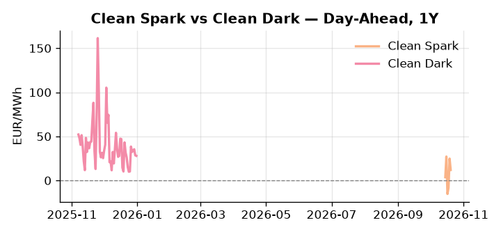
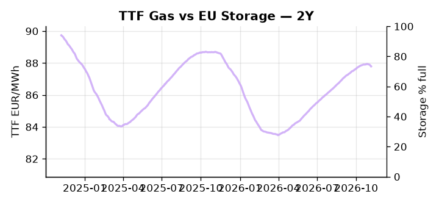

# European Cross-Commodity Risk Pack: Gas + Carbon → Power Curve Implications

**Daily desk brief — 2026-11-07**  
_Author: Sumer Sener · sumerberksener@gmail.com_  
_Generated by `scripts/generate_brief.py`. AI narrative + news themes via Anthropic Claude._

> **Data-freshness caveat:** TTF Gas (last 2026-10-15, 23d old); Clean Spark (last 2026-10-20, 18d old); Clean Dark (last 2025-12-31, 311d old); Coal (last 2025-12-26, 316d old). Numbers below should be read with this in mind.

## 1 · Executive summary

**TL;DR — GB and DE power at 97th and 92nd percentiles respectively; storage 16pp below seasonal average; stale gas/coal data limits conviction on fuel-switch regime.**

GB and DE power are printing at the 97th and 92nd percentiles respectively — 232.7 EUR/MWh and 263.84 EUR/MWh — driven by renewables at only the 24th percentile (32.08% of load, down 17.57% on the day) forcing an extended thermal call against a storage buffer already 16.3 percentage points below its five-year seasonal average. With TTF stale at 23 days (85.59 EUR/MWh) and coal data 316 days old, the fuel-switch regime is indicative not bankable, and clean spark and dark spread conviction is severely limited until fresher gas and coal prints are available. UK-EU electricity deal momentum remains the dominant bearish anchor for forward curves, with cross-border import elasticity compressed until a signature unlocks interconnector headroom over a weeks horizon. Colombian hydro stress adds a tail-risk bid to Atlantic LNG availability, leaving front-month gas exposed to a supply-side squeeze that the stale data cannot currently quantify. Gas tightness anchored by depleted storage AND carbon regime undefined pending ETS legislative review AND clean spreads indicative-only collectively hold the curve in an elevated, thermally-driven regime where Colombian LNG disruption is the clearest front-curve risk to the upside.

_Generated by **claude-sonnet-4-6** via Anthropic API (two-pass extract→narrate). Prompts/responses logged to `ai/logs/`._
_Next-5d temperature anomaly — DE -3.8°C / FR -1.4°C vs 5-yr seasonal normal (Open-Meteo)._

## 2 · Monitor metrics

**Primary (cross-commodity headline tiles)**

| Metric | As of | Latest | Unit | 1d Δ | 1w Δ | 5y pctile | Headline |
|---|---|---:|---|---:|---:|---:|---|
| TTF Gas | 2026-10-15 (STALE) | 85.59 | EUR/MWh | — | — | — | Within typical range |
| EU Storage | 2026-11-05 | 73.39 | % full | -0.47% | -1.03% | 60 | 16.3 pp below the 5-yr seasonal average |
| EUA Carbon | 2026-11-06 | 34.61 | EUR/tCO2 | -1.76% | +0.96% | 53 | outsized daily move (-1.76%, 2.1σ) |
| DE Power | 2026-11-07 | 263.84 | EUR/MWh | -4.38% | -3.79% | 92 | 92th-percentile of 5-yr range — historically high |
| GB Power | 2026-11-07 | 232.70 | EUR/MWh | -15.88% | -3.76% | 97 | 97th-percentile of 5-yr range — historically high |
| Renewables | 2026-11-06 | 32.08 | % of load | -17.57% | +73.50% | 24 | Within typical range |
| Clean Spark | 2026-10-20 (STALE) | 11.94 | EUR/MWh | -12.84 | — | — | Within typical range |
| Clean Dark | 2025-12-31 (STALE) | 27.95 | EUR/MWh | -0.56 | +11.63 | 47 | Within typical range |

**Fundamentals inputs** _(feed derived metrics; not separately traded)_

| Metric | As of | Latest | Unit | 1d Δ | 1w Δ | 5y pctile | Headline |
|---|---|---:|---|---:|---:|---:|---|
| Coal | 2025-12-26 (STALE) | 96.00 | USD/t | -0.57% | +0.08% | 8 | 8th-percentile of 5-yr range — historically low |

_Spreads → abs EUR/MWh deltas; others → pct. Weekly Δ uses 5d trailing means. Full history in `data/<metric>.csv`._

## 3 · Gas + LNG arb

**TTF front-month** prints at 85.59 EUR/MWh — _Within typical range_.
**EU storage** at 73.4% full (-16.3 pp vs 5-yr seasonal avg) — _16.3 pp below the 5-yr seasonal average_.
**TTF − JKM (LNG arb)** at -7.42 EUR/MWh (JKM 31.49 USD/MMBtu) — JKM richer than TTF — Asia pulls cargoes, marginal European tightening risk.

## 4 · Carbon (EU ETS)

**EUA December** prints at 34.61 EUR/tCO2 — _outsized daily move (-1.76%, 2.1σ)_. A euro of EUA adds ~0.37 EUR/MWh to gas-fired and ~0.85 EUR/MWh to coal-fired generation cost; strength compresses the dark spread faster than the spark.

**EU vs UK ETS** — Cobblestone's emissions desk trades EUA and UKA. Post-Brexit auction reform narrowed the UKA discount to EUA from £20+/t to single-digit £/t; CBAM phase-in pulls UK compliance demand toward parity. EUA−UKA basis remains a tradable cross-market signal.

**Supply / policy signal** — _CBAM full operational phase live since 1 Jan 2026 — importers paying for embedded emissions_  
Side: `policy` · Polarity: `bullish EUA` · Source: EU Regulation 2023/956 (CBAM)

Domestic carbon-cost burden gradually levelled with imports; supports EUA demand floor as carbon leakage protection tightens through 2034.

_No ETS-relevant news surfaced today — falling back to `data/policy_facts.py` (hand-maintained structural fact pack). Fact pack last reviewed 2026-05-08 (183d ago)._

## 5 · Power — Day-Ahead & curve

**DE day-ahead baseload** at 263.84 EUR/MWh — _92th-percentile of 5-yr range — historically high_.
**GB day-ahead baseload** at 232.70 EUR/MWh — _97th-percentile of 5-yr range — historically high_.
**DE − GB spread** at +31.14 EUR/MWh (DE premium) — drives interconnector flow direction.
**Cross-border net flows (Power Transportation):** DE↔FR -2.3 GWh (FR export); GB↔FR +0.6 GWh (GB export); NL↔DE +47.1 GWh (NL export).

**Clean spark spread** at +11.94 EUR/MWh — _Within typical range_. Bridge from gas + carbon fundamentals to gas-fired economics; sustained positive spark = TTF moves transmit directly into the power curve.

**Curve shape:** DA → W+1 → M+1 → Q+1 → Cal+1 → Cal+2 = 264 / 204 / 204 / 204 / 204 / 204 EUR/MWh — **Backwardation** (DA −Cal+1 spread +60 EUR/MWh). Forwards are seasonality projections — see Methodology.

{width=49%} {width=49%}

**This week ahead**

- **Tue** 08:00 UTC — AGSI+ daily storage print: First read on the week's gas injection / withdrawal pace; sets the tone for TTF curve shape.
- **Wed** 09:00 UTC — EEX EUA primary auction (Mon–Thu daily; Wed is largest volume): Supply-side EUA signal; auction clearing relative to spot reads as ETS demand strength.
- **Wed** — ENTSO-E DE_LU + GB next-week wind/solar forecast refresh: Sets the residual-load curve a week out; outsized prints move power Cal+1 directionally.

**Scenarios (1w horizon)**

| | Summary | TTF | DE Power |
|---|---|---:|---:|
| **Base** | Power remains elevated; storage refill settles; UK-EU deal talks drag but no shock. | tracks | -5 to -8% |
| **Upside** | Colombian hydro failure tightens Atlantic LNG; Chernobyl cascades into Central EU outage; storage refill pace slows. | +8-12% | +12-18% |
| **Downside** | UK-EU electricity deal signed, interconnector arbitrage flows increase; renewables recover; storage refills faster. | -3-5% | -15-22% |

_Illustrative, not forecasts. Magnitudes sized off historical sensitivity; AI-generated from today's extract pass._

## 6 · Today's themes

**Weather watch (next 7d)**
- **Storm · FR · Thu 12 – Fri 13 Nov** — peak gust 37 m/s (~132 km/h) on Fri 13 Nov. Strong wind boost to French generation; FR may export to neighbours. DA print likely below seasonal norm; watch FR-GB IFA flow toward GB.
- **Cold snap · DE · Sat 07 – Fri 13 Nov** — peak -5.1°C vs normal. Bullish DE power and TTF — heating demand pulls thermal plant up the merit order. Spark spread expands; watch DE−GB spread widen on the DE side.

**Watchlist (1–4 weeks)**
- UK-EU electricity deal signature and implementation timeline for interconnector agreements.
- French presidential election outcome (Mélenchon platform) and EU energy policy confrontation risk.

_Risk framing — built within a discipline of clear limits and continuous monitoring; observations here are framed as risk inputs, not directional calls. Positioning decisions remain with the desk._
_Methodology + sources: **README §Methodology**. Numbers auditable via the snapshot JSONs. Rule-based / informational — not investment advice._