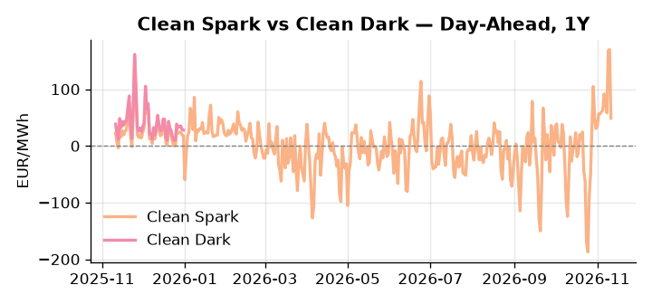
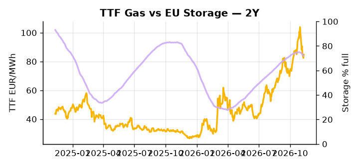

# European Cross-Commodity Risk Pack: Gas + Carbon → Power Curve Implications

**Daily desk brief — 2026-11-11**  
_Author: Sumer Sener · sumerberksener@gmail.com_  
_Generated by `scripts/generate_brief.py`. AI narrative + news themes via Anthropic Claude._

> **Data-freshness caveat:** Clean Dark (last 2025-12-31, 315d old); Coal (last 2025-12-26, 320d old). Numbers below should be read with this in mind.

## 1 · Executive summary

**TL;DR — Renewables at 2nd-percentile collapse drives thermal stack into merit; GB power at 95th-percentile premium widens fuel-switch risk vs. continent; storage 17pp below seasonal average tightens winter refill.**

Renewables collapsed to the 2nd percentile (11.2% share, -77% month-on-month), forcing the full thermal stack into merit and driving the Clean Spark to the 94th percentile at 48.91 EUR/MWh — a fuel-switch extreme that is anchoring front-month gas and power elevated across both GB and continental curves. GB power at the 95th percentile (208.97 EUR/MWh) sits in tight arbitrage tension against DE power at the 90th percentile (231.29 EUR/MWh), with the pending UK-EU interconnector deal representing the primary headroom-compression risk to that spread. EU storage at 72% full — 17.2 percentage points below the seasonal average — keeps TTF (79th percentile, 84.73 EUR/MWh) extended on the front curve, with any cold-weather turn threatening to widen the winter refill deficit further; note that with coal data 320 days old and clean dark 315 days old, the dark spread is indicative not bankable. EUA valuations carry an emerging policy shadow as a populist surge and the Spain snap election in late November 2026 raise conservative-victory risk that would relax EU ETS enforcement and decelerate electrification targets, bearing down on the multi-year carbon curve on weaker demand assumptions. With Mediterranean corridor tail-risk reasserting alongside the storage deficit, gas tightness AND EUA mid-range under bearish policy pressure AND clean sparks deep in-the-money keep the front-curve risk wide while the Cal+1 regime hinges on whether the Turkey-Greece corridor escalation tightens alternative LNG import routes before winter refill pace normalises.

_Generated by **claude-sonnet-4-6** via Anthropic API (two-pass extract→narrate). Prompts/responses logged to `ai/logs/`._
_Next-5d temperature anomaly — DE -2.0°C / FR -1.0°C / GB -4.2°C vs 5-yr seasonal normal (Open-Meteo)._

## 2 · Monitor metrics

**Primary (cross-commodity headline tiles)**

| Metric | As of | Latest | Unit | 1d Δ | 1w Δ | 5y pctile | Headline |
|---|---|---:|---|---:|---:|---:|---|
| TTF Gas | 2026-11-10 | 84.73 | EUR/MWh | +2.71% | -11.87% | 79 | Within typical range |
| EU Storage | 2026-11-09 | 72.00 | % full | -0.54% | -2.12% | 57 | 17.2 pp below the 5-yr seasonal average |
| EUA Carbon | 2026-11-10 | 35.11 | EUR/tCO2 | +0.20% | +0.03% | 56 | Within typical range |
| DE Power | 2026-11-11 | 231.29 | EUR/MWh | -34.35% | +10.59% | 90 | Within typical range |
| GB Power | 2026-11-11 | 208.97 | EUR/MWh | -18.69% | +3.47% | 95 | 95th-percentile of 5-yr range — historically high |
| Renewables | 2026-11-10 | 11.20 | % of load | +8.30% | -41.14% | 2 | 2th-percentile of 5-yr range — historically low |
| Clean Spark | 2026-11-11 | 48.91 | EUR/MWh | -121.04 | +38.59 | 94 | 94th-percentile of 5-yr range — historically high |
| Clean Dark | 2025-12-31 (STALE) | 27.95 | EUR/MWh | -0.56 | +11.63 | 47 | Within typical range |

**Fundamentals inputs** _(feed derived metrics; not separately traded)_

| Metric | As of | Latest | Unit | 1d Δ | 1w Δ | 5y pctile | Headline |
|---|---|---:|---|---:|---:|---:|---|
| Coal | 2025-12-26 (STALE) | 96.00 | USD/t | -0.57% | +0.08% | 8 | 8th-percentile of 5-yr range — historically low |

_Spreads → abs EUR/MWh deltas; others → pct. Weekly Δ uses 5d trailing means. Full history in `data/<metric>.csv`._

## 3 · Gas + LNG arb

**TTF front-month** prints at 84.73 EUR/MWh — _Within typical range_.
**EU storage** at 72.0% full (-17.2 pp vs 5-yr seasonal avg) — _17.2 pp below the 5-yr seasonal average_.
**TTF − JKM (LNG arb)** at -10.54 EUR/MWh (JKM 31.33 USD/MMBtu) — JKM richer than TTF — Asia pulls cargoes, marginal European tightening risk.

## 4 · Carbon (EU ETS)

**EUA December** prints at 35.11 EUR/tCO2 — _Within typical range_. A euro of EUA adds ~0.37 EUR/MWh to gas-fired and ~0.85 EUR/MWh to coal-fired generation cost; strength compresses the dark spread faster than the spark.

**EU vs UK ETS** — Cobblestone's emissions desk trades EUA and UKA. Post-Brexit auction reform narrowed the UKA discount to EUA from £20+/t to single-digit £/t; CBAM phase-in pulls UK compliance demand toward parity. EUA−UKA basis remains a tradable cross-market signal.

**Supply / policy signal** — _Populist surge threatens to unwind EU climate policy consensus post-COP31; Spain snap election (late November 2026) poses conservative victory risk to EU ETS enforcement and electrification targets._  
Side: `policy` · Polarity: `bearish EUA` · Source: Politico EU Energy

Conservative election victory in Spain would relax climate policy enforcement and decelerate power decarbonization urgency, pressuring EUA valuations and multi-year carbon curve on weaker demand assumptions.

_Surfaced from today's news flow by the AI extract pass (`ai/prompts/extract_v1.md` → `carbon_policy_signal`)._

## 5 · Power — Day-Ahead & curve

**DE day-ahead baseload** at 231.29 EUR/MWh — _Within typical range_.
**GB day-ahead baseload** at 208.97 EUR/MWh — _95th-percentile of 5-yr range — historically high_.
**DE − GB spread** at +22.32 EUR/MWh (DE premium) — drives interconnector flow direction.
**Cross-border net flows (Power Transportation):** DE↔FR -66.9 GWh (FR export); GB↔FR +3.5 GWh (GB export); NL↔DE +66.3 GWh (NL export).

**Clean spark spread** at +48.91 EUR/MWh — _94th-percentile of 5-yr range — historically high_. Bridge from gas + carbon fundamentals to gas-fired economics; sustained positive spark = TTF moves transmit directly into the power curve.

**Curve shape:** DA → W+1 → M+1 → Q+1 → Cal+1 → Cal+2 = 231 / 222 / 222 / 222 / 222 / 222 EUR/MWh — **Backwardation** (DA −Cal+1 spread +9 EUR/MWh). Forwards are seasonality projections — see Methodology.

{width=49%} {width=49%}

**This week ahead**

- **Wed** 09:00 UTC — EEX EUA primary auction (Mon–Thu daily; Wed is largest volume): Supply-side EUA signal; auction clearing relative to spot reads as ETS demand strength.
- **Wed** — ENTSO-E DE_LU + GB next-week wind/solar forecast refresh: Sets the residual-load curve a week out; outsized prints move power Cal+1 directionally.
- **Fri** 14:30 UTC — EIA weekly natural gas storage report: US storage trajectory anchors LNG export pricing into NW Europe — direct TTF transmission.
- **Nov** — Spain snap election (late Nov 2026): Conservative victory could relax EU climate policy urgency and pressure EUA curve; downside to multi-year power decarbonization demand. _(news-extracted)_
- **Nov** — UK-EU electricity deal finalization: Increased interconnector capacity triggers cross-Channel price arbitrage; likely DA and Cal+1 compression if UK power cheaper than continental. _(news-extracted)_

**Scenarios (24-72h | 1w horizon)**

| | Summary | TTF | DE Power |
|---|---|---:|---:|
| **Base** | Renewables recovery modest; thermal stack stays high; GB-EU spread narrows gradually on interconnector progress. | ±1-3% | ±2-4% |
| **Upside** | Cold front + renewable lows persist; storage refill slows; Mediterranean gas corridor escalation tightens supply certainty. | +8-12% | +12-18% |
| **Downside** | Renewable recovery accelerates; UK-EU interconnector finalized with full arbitrage capacity; Spain conservative election relaxes climate demand. | -6-10% | -10-15% |

_Illustrative, not forecasts. Magnitudes sized off historical sensitivity; AI-generated from today's extract pass._

## 6 · Today's themes

**Weather watch (next 7d)**
- **Storm · GB · Wed 11 – Fri 13 Nov** — peak gust 40 m/s (~144 km/h) on Thu 12 Nov. GB wind capacity is large — DA likely soft. Cut-off risk if gusts exceed safety thresholds; opposite tail (sudden tightening) possible.
- **Storm · DE · Thu 12 – Sun 15 Nov** — peak gust 48 m/s (~174 km/h) on Fri 13 Nov. Wind generation likely surges Day 1, then risk of turbine cut-off if gusts exceed 25 m/s. Bearish DA early, sharp reversal possible. Watch DE-FR flow swings.

**Watchlist (1–4 weeks)**
- Spain snap election (later November 2026) — conservative climate-policy relaxation risk.
- UK-EU electricity deal finalization — interconnector capacity/price arbitrage impact timing.

> **Cross-market regime tag:** Tight market: TTF rich vs history while storage runs below seasonal.

_Risk framing — built within a discipline of clear limits and continuous monitoring; observations here are framed as risk inputs, not directional calls. Positioning decisions remain with the desk._
_Methodology + sources: **README §Methodology**. Numbers auditable via the snapshot JSONs. Rule-based / informational — not investment advice._