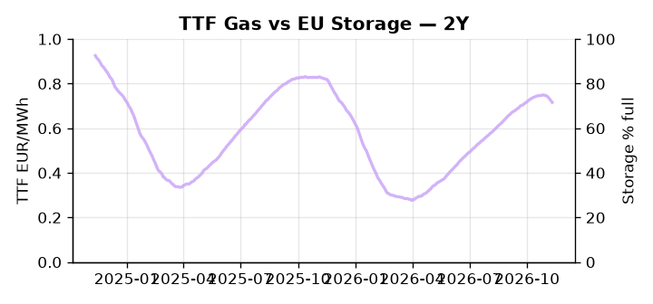

# European Cross-Commodity Risk Pack: Gas + Carbon → Power Curve Implications

**Daily desk brief — 2026-11-12**  
_Author: Sumer Sener · sumerberksener@gmail.com_  
_Generated by `scripts/generate_brief.py`. AI narrative + news themes via Anthropic Claude._

> **Data-freshness caveat:** Coal (last 2025-12-26, 321d old). Numbers below should be read with this in mind.

## 1 · Executive summary

**TL;DR — Renewables at 3rd-percentile (13.18% load) force extreme thermal call; GB power at 93rd-percentile (195.26 EUR/MWh) signals tight capacity; storage 17.5pp below seasonal average underpins H2 refill risk.**

Renewables have collapsed to the 3rd-percentile of their five-year range (13.18% load share, -58.6% month-on-month), forcing an extreme thermal call with no baseload floor yet visible in the day-ahead, while GB power sits at the 93rd-percentile (195.26 EUR/MWh) on tight capacity and a delayed EU-UK interconnector agreement that continues to widen the arbitrage spread. Storage at 71.61% full — 17.5 percentage points below seasonal trend — enters the refill window in a structurally compromised position, anchoring H2 winter curve risk and keeping the injection pace through December-January the dominant Cal+1 variable to watch. EUA at 35.37 EUR/t (57th-percentile) holds a mid-range posture as Poland's court upholding of seven major climate laws removes coal phase-out rollback risk and reinforces the EUA price floor through the 2030s decarbonisation trajectory. With coal data 321 days stale, the clean-dark spread is indicative not bankable, disqualifying merit-order thermal dispatch analysis until a refresh. Extreme thermal call from renewables at the 3rd-percentile, EUA anchored at mid-range with policy backstop intact, and clean-spark differentials compressed by the EU-UK interconnector delay keep the front-curve regime tight, with the pending interconnector signing the single switch that could shift Cal+1 from extended GB premium into cross-border spread compression.

_Generated by **claude-sonnet-4-6** via Anthropic API (two-pass extract→narrate). Prompts/responses logged to `ai/logs/`._
_Next-5d temperature anomaly — DE -1.0°C / FR -1.8°C vs 5-yr seasonal normal (Open-Meteo)._

## 2 · Monitor metrics

**Primary (cross-commodity headline tiles)**

| Metric | As of | Latest | Unit | 1d Δ | 1w Δ | 5y pctile | Headline |
|---|---|---:|---|---:|---:|---:|---|
| TTF Gas | — | — | EUR/MWh | — | — | — | (no data) |
| EU Storage | 2026-11-10 | 71.61 | % full | -0.54% | -2.28% | 57 | 17.5 pp below the 5-yr seasonal average |
| EUA Carbon | 2026-11-11 | 35.37 | EUR/tCO2 | +0.75% | -0.42% | 57 | Within typical range |
| DE Power | — | — | EUR/MWh | — | — | — | (no data) |
| GB Power | 2026-11-12 | 195.26 | EUR/MWh | -19.07% | +3.08% | 93 | 93th-percentile of 5-yr range — historically high |
| Renewables | 2026-11-11 | 13.18 | % of load | +17.63% | -58.67% | 3 | 3th-percentile of 5-yr range — historically low |
| Clean Spark | — | — | EUR/MWh | — | — | — | (no data) |
| Clean Dark | — | — | EUR/MWh | — | — | — | (no data) |

**Fundamentals inputs** _(feed derived metrics; not separately traded)_

| Metric | As of | Latest | Unit | 1d Δ | 1w Δ | 5y pctile | Headline |
|---|---|---:|---|---:|---:|---:|---|
| Coal | 2025-12-26 (STALE) | 96.00 | USD/t | -0.57% | +0.08% | 8 | 8th-percentile of 5-yr range — historically low |

_Spreads → abs EUR/MWh deltas; others → pct. Weekly Δ uses 5d trailing means. Full history in `data/<metric>.csv`._

## 3 · Gas + LNG arb

**EU storage** at 71.6% full (-17.5 pp vs 5-yr seasonal avg) — _17.5 pp below the 5-yr seasonal average_.

## 4 · Carbon (EU ETS)

**EUA December** prints at 35.37 EUR/tCO2 — _Within typical range_. A euro of EUA adds ~0.37 EUR/MWh to gas-fired and ~0.85 EUR/MWh to coal-fired generation cost; strength compresses the dark spread faster than the spark.

**EU vs UK ETS** — Cobblestone's emissions desk trades EUA and UKA. Post-Brexit auction reform narrowed the UKA discount to EUA from £20+/t to single-digit £/t; CBAM phase-in pulls UK compliance demand toward parity. EUA−UKA basis remains a tradable cross-market signal.

**Supply / policy signal** — _Poland court upholds seven major climate laws, rejecting bid to overturn EU ETS compliance and coal phase-out obligations._  
Side: `policy` · Polarity: `bullish EUA` · Source: Politico EU Energy

Removes rollback risk on coal phase-out and ETS enforcement; supports EUA price floor and reduces downside tail on decarbonisation trajectory through 2030s.

_Surfaced from today's news flow by the AI extract pass (`ai/prompts/extract_v1.md` → `carbon_policy_signal`)._

## 5 · Power — Day-Ahead & curve

**GB day-ahead baseload** at 195.26 EUR/MWh — _93th-percentile of 5-yr range — historically high_.
**Cross-border net flows (Power Transportation):** DE↔FR -70.0 GWh (FR export); GB↔FR -41.8 GWh (FR export); NL↔DE +44.1 GWh (NL export).

**This week ahead**

- **Fri** 14:30 UTC — EIA weekly natural gas storage report: US storage trajectory anchors LNG export pricing into NW Europe — direct TTF transmission.
- **Thu** 14:30 UTC — US EIA weekly crude inventories: Crude — and via crack spreads, refined-products — feed back into LNG arb economics.
- **Fri** — ENTSO-E weekly day-ahead volumes / system-balance summary: Reads the European generation mix in last 7d — confirms or breaks the Cal+1 thesis.
- **Late Nov** — Spain snap election — climate policy direction: Conservative victory could relax coal phase-out and renewable auction pace; bearish for EUA floor and power curve. _(news-extracted)_
- **TBD** — EU-UK electricity interconnector signing: Delays prolong GB-EU DA spread arbitrage; signature unlocks cross-border flattening and Cal+1 differential compression. _(news-extracted)_

**Scenarios (24-72h | 1w horizon)**

| | Summary | TTF | DE Power |
|---|---|---:|---:|
| **Base** | Renewables stay subdued; thermal dispatch sustained; GB premium holds elevated; storage refill continues at trend pace. | tracks | tracks |
| **Upside** | Wind event lifts renewables +8–12pp; thermal call collapses 15–20%; GB spreads compress on interconnector progress news. | -8-12% | -15-20% |
| **Downside** | Renewables extend tail below 10% load; thermal call peaks; Spain election win by climate-skeptic coalition delays coal phase-out. | +5-10% | +10-15% |

_Illustrative, not forecasts. Magnitudes sized off historical sensitivity; AI-generated from today's extract pass._

## 6 · Today's themes

**Weather watch (next 7d)**
- **Storm · DE · Fri 13 – Wed 18 Nov** — peak gust 44 m/s (~157 km/h) on Fri 13 Nov. Wind generation likely surges Day 1, then risk of turbine cut-off if gusts exceed 25 m/s. Bearish DA early, sharp reversal possible. Watch DE-FR flow swings.
- **Storm · FR · Sun 15 – Wed 18 Nov** — peak gust 50 m/s (~181 km/h) on Sun 15 Nov. Strong wind boost to French generation; FR may export to neighbours. DA print likely below seasonal norm; watch FR-GB IFA flow toward GB.

**Watchlist (1–4 weeks)**
- Spain snap election late November—climate policy direction for EU coal phase-out and renewable support.
- COP31 electrification commitments finalisation—watches long-term power demand and EUA cap trajectory.

_Risk framing — built within a discipline of clear limits and continuous monitoring; observations here are framed as risk inputs, not directional calls. Positioning decisions remain with the desk._
_Methodology + sources: **README §Methodology**. Numbers auditable via the snapshot JSONs. Rule-based / informational — not investment advice._