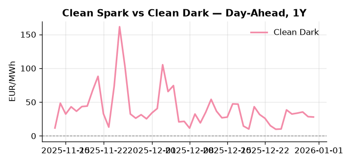
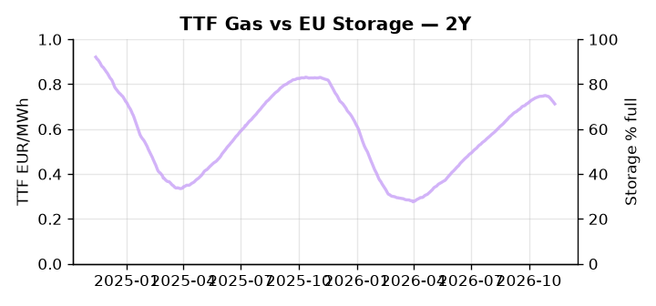

# European Cross-Commodity Risk Pack: Gas + Carbon → Power Curve Implications

**Daily desk brief — 2026-11-13**  
_Author: Sumer Sener · sumerberksener@gmail.com_  
_Generated by `scripts/generate_brief.py`. AI narrative + news themes via Anthropic Claude._

> **Data-freshness caveat:** Clean Dark (last 2025-12-31, 317d old); Coal (last 2025-12-26, 322d old). Numbers below should be read with this in mind.

## 1 · Executive summary

**TL;DR — GB Power at 96th-percentile (229 EUR/MWh) dominates; EU storage 17.7pp below seasonal average tightens winter gas call; Spain election risk to renewables deployment.**

GB Power is the dominant signal this morning, printing at the 96th percentile — 229 EUR/MWh, up 6.73% on the day — pointing to acute supply stress or a demand surge in the GB system that warrants immediate scrutiny of LNG nominations and interconnect flows. EU storage at 71.25%, running 17.7 percentage points below seasonal average, keeps the winter gas call tight and elevates the thermal merit order heading into the 2026–27 refill crunch. EUA regulatory certainty is reinforced after the EU court rejected Poland's bid to overturn seven major climate laws, confirming ETS compliance intact through the 2027 calendar and supporting the carbon floor for marginal-cost hedging — a slow-motion supply-side anchor for carbon. With coal data 322 days old and clean dark spreads 317 days stale, thermal economics are indicative not bankable, leaving the coal merit-order inference unreliable until refreshed. With the Spain snap election in November carrying tail-risk of conservative RES rollback into the Q1 2027 curve, gas tightness at 17.7pp storage deficit AND EUA floor anchored by confirmed regulatory certainty AND clean dark spreads too stale to clear the signal → the front-curve regime is extended and Spain election outcome is the dominant event risk transmitting to Cal+1 spark differential.

_Generated by **claude-sonnet-4-6** via Anthropic API (two-pass extract→narrate). Prompts/responses logged to `ai/logs/`._

## 2 · Monitor metrics

**Primary (cross-commodity headline tiles)**

| Metric | As of | Latest | Unit | 1d Δ | 1w Δ | 5y pctile | Headline |
|---|---|---:|---|---:|---:|---:|---|
| TTF Gas | — | — | EUR/MWh | — | — | — | (no data) |
| EU Storage | 2026-11-11 | 71.25 | % full | -0.49% | -2.34% | 56 | 17.7 pp below the 5-yr seasonal average |
| EUA Carbon | 2026-11-12 | 35.58 | EUR/tCO2 | +0.58% | -0.37% | 58 | Within typical range |
| DE Power | 2026-11-13 | 145.39 | EUR/MWh | -26.86% | +5.76% | 76 | Within typical range |
| GB Power | 2026-11-13 | 229.11 | EUR/MWh | +6.73% | +2.84% | 96 | 96th-percentile of 5-yr range — historically high |
| Renewables | — | — | % of load | — | — | — | (no data) |
| Clean Spark | — | — | EUR/MWh | — | — | — | (no data) |
| Clean Dark | 2025-12-31 (STALE) | 27.95 | EUR/MWh | -0.56 | +11.63 | 48 | Within typical range |

**Fundamentals inputs** _(feed derived metrics; not separately traded)_

| Metric | As of | Latest | Unit | 1d Δ | 1w Δ | 5y pctile | Headline |
|---|---|---:|---|---:|---:|---:|---|
| Coal | 2025-12-26 (STALE) | 96.00 | USD/t | -0.57% | +0.08% | 8 | 8th-percentile of 5-yr range — historically low |

_Spreads → abs EUR/MWh deltas; others → pct. Weekly Δ uses 5d trailing means. Full history in `data/<metric>.csv`._

## 3 · Gas + LNG arb

**EU storage** at 71.2% full (-17.7 pp vs 5-yr seasonal avg) — _17.7 pp below the 5-yr seasonal average_.

## 4 · Carbon (EU ETS)

**EUA December** prints at 35.58 EUR/tCO2 — _Within typical range_. A euro of EUA adds ~0.37 EUR/MWh to gas-fired and ~0.85 EUR/MWh to coal-fired generation cost; strength compresses the dark spread faster than the spark.

**EU vs UK ETS** — Cobblestone's emissions desk trades EUA and UKA. Post-Brexit auction reform narrowed the UKA discount to EUA from £20+/t to single-digit £/t; CBAM phase-in pulls UK compliance demand toward parity. EUA−UKA basis remains a tradable cross-market signal.

**Supply / policy signal** — _EU court rejects Poland's bid to overturn seven major climate laws; ETS compliance and carbon regulations confirmed intact._  
Side: `supply` · Polarity: `bullish EUA` · Source: Politico EU Energy

Confirms EUA regulatory certainty through 2027 calendar; reduces whipsaw risk and supports carbon floor for power marginal-cost hedging.

_Surfaced from today's news flow by the AI extract pass (`ai/prompts/extract_v1.md` → `carbon_policy_signal`)._

## 5 · Power — Day-Ahead & curve

**DE day-ahead baseload** at 145.39 EUR/MWh — _Within typical range_.
**GB day-ahead baseload** at 229.11 EUR/MWh — _96th-percentile of 5-yr range — historically high_.
**DE − GB spread** at -83.72 EUR/MWh (GB premium) — drives interconnector flow direction.
**Cross-border net flows (Power Transportation):** NL↔DE +21.9 GWh (NL export).

**Curve shape:** DA → W+1 → M+1 → Q+1 → Cal+1 → Cal+2 = 145 / 216 / 216 / 216 / 216 / 216 EUR/MWh — **Contango** (DA −Cal+1 spread -71 EUR/MWh). Forwards are seasonality projections — see Methodology.

{width=49%} {width=49%}

**This week ahead**

- **Fri** 14:30 UTC — EIA weekly natural gas storage report: US storage trajectory anchors LNG export pricing into NW Europe — direct TTF transmission.
- **Fri** — ENTSO-E weekly day-ahead volumes / system-balance summary: Reads the European generation mix in last 7d — confirms or breaks the Cal+1 thesis.
- **Tue** 08:00 UTC — AGSI+ daily storage print: First read on the week's gas injection / withdrawal pace; sets the tone for TTF curve shape.
- **Nov** — Spain snap election — RES policy vote: Conservative win risks climate rule relaxation, slowing wind/solar deployment and tightening 2027 power supply. _(news-extracted)_

**Scenarios (1w horizon)**

| | Summary | TTF | DE Power |
|---|---|---:|---:|
| **Base** | GB supply tightness persists; EU storage refill steady; Spain election outcome uncertain. | tracks | +2-5% |
| **Upside** | Spain conservatives win, relax RES rules; EU wind output drops; storage refill slows further. | +8-12% | +12-18% |
| **Downside** | Spain socialists maintain power; GB supply normalizes; EU storage refill accelerates on mild weather. | -5-8% | -8-12% |

_Illustrative, not forecasts. Magnitudes sized off historical sensitivity; AI-generated from today's extract pass._

## 6 · Today's themes

**Watchlist (1–4 weeks)**
- Spain snap election later November—potential climate policy reset; monitor gas/power curve impact.
- COP31 electrification pledge enforcement detail—check if binding timelines or soft targets; affects CCGT retirement assumptions.

_Risk framing — built within a discipline of clear limits and continuous monitoring; observations here are framed as risk inputs, not directional calls. Positioning decisions remain with the desk._
_Methodology + sources: **README §Methodology**. Numbers auditable via the snapshot JSONs. Rule-based / informational — not investment advice._