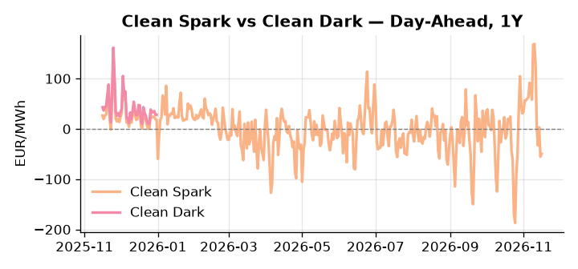
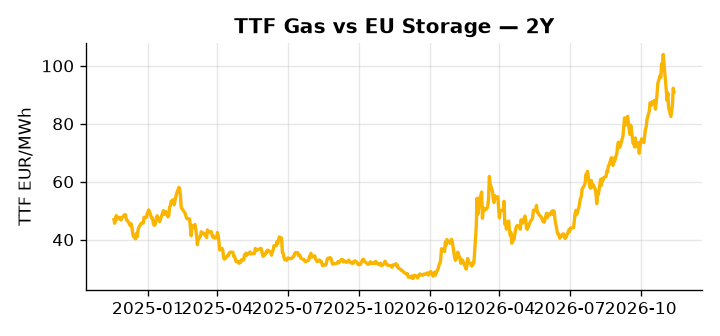

# European Cross-Commodity Risk Pack: Gas + Carbon → Power Curve Implications

**Daily desk brief — 2026-11-16**  
_Author: Sumer Sener · sumerberksener@gmail.com_  
_Generated by `scripts/generate_brief.py`. AI narrative + news themes via Anthropic Claude._

> **Data-freshness caveat:** Clean Dark (last 2025-12-31, 320d old); Coal (last 2025-12-26, 325d old). Numbers below should be read with this in mind.

## 1 · Executive summary

**TL;DR — GB Power at 93rd-percentile, EUA selling off (-1.91%, 2.1σ) despite COP31 fossil-transition rhetoric; Arctic LNG reroute to Asia from 2027 tightens EU gas supply and supports power baseload.**

GB Power is printing at the 93rd percentile yet sold off 15.21% intraday — a move that reads as constraint-driven structural tightness rather than weather-driven mean reversion, and the dominant signal entering the session. EUA slipped 1.91% (a 2.1σ move lower) despite COP31 draft text signalling an immediate fossil-fuel transition commitment that, if binding, would accelerate thermal displacement and raise the EUA floor via stricter Phase 2 carbon budgets — the sell-off therefore looks like profit-taking into the policy headline rather than a regime shift. Arctic LNG rerouting to Asia from 2027 narrows EU swing supply optionality and props the TTF seasonal curve, keeping the gas risk premium extended on the forward strip. With coal and clean-dark spread data 320–325 days old, the 8th-percentile coal read and any dark-spread inference are indicative not bankable, leaving merit-order signals unconfirmed. Gas tightness anchored by the Arctic LNG reroute AND EUA mid-range with COP31 binding-language tail risk still live AND clean spreads unconfirmed by stale dark-spread data keep the front-curve regime structurally bid, with the Arctic supply constraint the dominant driver pulling front-curve risk wider even as the Cal+1 regime awaits Thursday's COP31 final text to resolve the fuel-switch headroom.

_Generated by **claude-sonnet-4-6** via Anthropic API (two-pass extract→narrate). Prompts/responses logged to `ai/logs/`._
_Next-5d temperature anomaly — DE +2.5°C / FR +4.2°C / GB +0.5°C vs 5-yr seasonal normal (Open-Meteo)._

## 2 · Monitor metrics

**Primary (cross-commodity headline tiles)**

| Metric | As of | Latest | Unit | 1d Δ | 1w Δ | 5y pctile | Headline |
|---|---|---:|---|---:|---:|---:|---|
| TTF Gas | 2026-11-13 | 90.95 | EUR/MWh | -1.42% | -3.04% | 81 | Within typical range |
| EU Storage | — | — | % full | — | — | — | (no data) |
| EUA Carbon | 2026-11-13 | 34.90 | EUR/tCO2 | -1.91% | +0.01% | 54 | outsized daily move (-1.91%, 2.1σ) |
| DE Power | 2026-11-16 | 145.00 | EUR/MWh | +4.08% | -44.40% | 76 | Within typical range |
| GB Power | 2026-11-16 | 210.48 | EUR/MWh | -15.21% | -12.25% | 93 | 93th-percentile of 5-yr range — historically high |
| Renewables | 2026-11-15 | 65.27 | % of load | +32.94% | +162.33% | 87 | Within typical range |
| Clean Spark | 2026-11-16 | -49.75 | EUR/MWh | +5.68 | -147.02 | 16 | Within typical range |
| Clean Dark | 2025-12-31 (STALE) | 27.95 | EUR/MWh | -0.56 | +11.63 | 48 | Within typical range |

**Fundamentals inputs** _(feed derived metrics; not separately traded)_

| Metric | As of | Latest | Unit | 1d Δ | 1w Δ | 5y pctile | Headline |
|---|---|---:|---|---:|---:|---:|---|
| Coal | 2025-12-26 (STALE) | 96.00 | USD/t | -0.57% | +0.08% | 8 | 8th-percentile of 5-yr range — historically low |

_Spreads → abs EUR/MWh deltas; others → pct. Weekly Δ uses 5d trailing means. Full history in `data/<metric>.csv`._

## 3 · Gas + LNG arb

**TTF front-month** prints at 90.95 EUR/MWh — _Within typical range_.
**TTF − JKM (LNG arb)** at -5.86 EUR/MWh (JKM 31.35 USD/MMBtu) — JKM richer than TTF — Asia pulls cargoes, marginal European tightening risk.

## 4 · Carbon (EU ETS)

**EUA December** prints at 34.90 EUR/tCO2 — _outsized daily move (-1.91%, 2.1σ)_. A euro of EUA adds ~0.37 EUR/MWh to gas-fired and ~0.85 EUR/MWh to coal-fired generation cost; strength compresses the dark spread faster than the spark.

**EU vs UK ETS** — Cobblestone's emissions desk trades EUA and UKA. Post-Brexit auction reform narrowed the UKA discount to EUA from £20+/t to single-digit £/t; CBAM phase-in pulls UK compliance demand toward parity. EUA−UKA basis remains a tradable cross-market signal.

**Supply / policy signal** — _COP31 draft text signals immediate fossil fuel transition commitment; EU Phase 2 ETS compliance tightens if binding._  
Side: `policy` · Polarity: `bullish EUA` · Source: Politico EU Energy

Binding coal phase-out language accelerates thermal displacement and raises EUA floor via stricter carbon budgets; supports fuel-switch margin compression in power generation.

_Surfaced from today's news flow by the AI extract pass (`ai/prompts/extract_v1.md` → `carbon_policy_signal`)._

## 5 · Power — Day-Ahead & curve

**DE day-ahead baseload** at 145.00 EUR/MWh — _Within typical range_.
**GB day-ahead baseload** at 210.48 EUR/MWh — _93th-percentile of 5-yr range — historically high_.
**DE − GB spread** at -65.48 EUR/MWh (GB premium) — drives interconnector flow direction.
**Cross-border net flows (Power Transportation):** DE↔FR -34.8 GWh (FR export); GB↔FR -73.5 GWh (FR export); NL↔DE -70.5 GWh (DE export).

**Clean spark spread** at -49.75 EUR/MWh — _Within typical range_. Bridge from gas + carbon fundamentals to gas-fired economics; sustained positive spark = TTF moves transmit directly into the power curve.

**Curve shape:** DA → W+1 → M+1 → Q+1 → Cal+1 → Cal+2 = 145 / 209 / 209 / 209 / 209 / 209 EUR/MWh — **Contango** (DA −Cal+1 spread -64 EUR/MWh). Forwards are seasonality projections — see Methodology.

{width=49%} {width=49%}

**This week ahead**

- **Tue** 08:00 UTC — AGSI+ daily storage print: First read on the week's gas injection / withdrawal pace; sets the tone for TTF curve shape.
- **Wed** 09:00 UTC — EEX EUA primary auction (Mon–Thu daily; Wed is largest volume): Supply-side EUA signal; auction clearing relative to spot reads as ETS demand strength.
- **Wed** — ENTSO-E DE_LU + GB next-week wind/solar forecast refresh: Sets the residual-load curve a week out; outsized prints move power Cal+1 directionally.
- **Thu** — COP31 fossil-fuel transition final text: Binding language on immediate coal phase-out or vague language reshapes EUA compliance curve and power fuel-switch economics near-term. _(news-extracted)_

**Scenarios (1w horizon)**

| | Summary | TTF | DE Power |
|---|---|---:|---:|
| **Base** | COP31 final text moderate on immediacy; GB grid stabilizes; renewables mean-revert to 55–60%. TTF flat to +2%, power -5% from highs. | ±1-3% | -3 to -8% |
| **Upside** | COP31 binding coal phase-out language + UK cold snap drives GB constraint tighter. EUA +8-12%, TTF +6-10%, power +12-18%. | +6-10% | +12-18% |
| **Downside** | COP31 fossil language watered down; EU electrification softening confirmed; mild winter. EUA -6-10%, power -15-22%, coal repricing higher. | -4-7% | -15-22% |

_Illustrative, not forecasts. Magnitudes sized off historical sensitivity; AI-generated from today's extract pass._

## 6 · Today's themes

**Weather watch (next 7d)**
- **Storm · DE · Mon 16 – Sat 21 Nov** — peak gust 60 m/s (~218 km/h) on Wed 18 Nov. Wind generation likely surges Day 1, then risk of turbine cut-off if gusts exceed 25 m/s. Bearish DA early, sharp reversal possible. Watch DE-FR flow swings.
- **Storm · FR · Mon 16 – Fri 20 Nov** — peak gust 66 m/s (~238 km/h) on Thu 19 Nov. Strong wind boost to French generation; FR may export to neighbours. DA print likely below seasonal norm; watch FR-GB IFA flow toward GB.

**Watchlist (1–4 weeks)**
- COP31 final text release and fossil-fuel transition language binding status.
- EU LNG import data post-2027 as Russian Yamal volumes redirect; monitor TTF seasonal curve impact.

_Risk framing — built within a discipline of clear limits and continuous monitoring; observations here are framed as risk inputs, not directional calls. Positioning decisions remain with the desk._
_Methodology + sources: **README §Methodology**. Numbers auditable via the snapshot JSONs. Rule-based / informational — not investment advice._