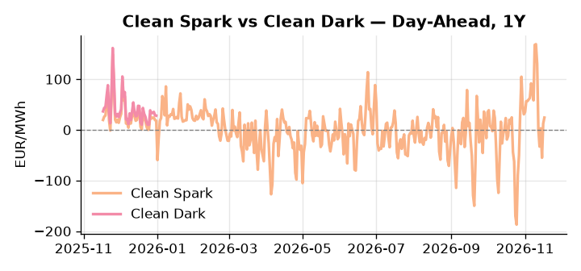
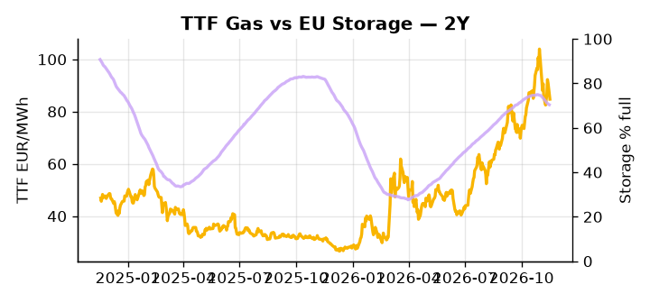

# European Cross-Commodity Risk Pack: Gas + Carbon → Power Curve Implications

**Daily desk brief — 2026-11-17**  
_Author: Sumer Sener · sumerberksener@gmail.com_  
_Generated by `scripts/generate_brief.py`. AI narrative + news themes via Anthropic Claude._

> **Data-freshness caveat:** Clean Dark (last 2025-12-31, 321d old); Coal (last 2025-12-26, 326d old). Numbers below should be read with this in mind.

## 1 · Executive summary

**TL;DR — GB Power at 91st-percentile amid tight storage (-18 pp seasonal) offsets collapsing coal (8th-percentile); EU bans Russian LNG from 2027, raising TTF forward curve via Atlantic/Pacific rerouting.**

GB Power at the 91st percentile is the dominant signal, sustained by storage sitting 18 percentage points below the five-year seasonal average and a renewable share swinging 312% week-on-week (89th percentile), which keeps thermal dispatch anchored as the marginal backstop. The EU's ban on Russian Yamal LNG from 2027 (~5 mtpa) is now the defining forward-curve driver, with Atlantic and Pacific rerouting locking in a structurally higher marginal supply cost and a TTF outsized daily move of -6.82% (2.1σ) already flagging volatility spillover into Cal+1 and calendar spreads. EUA sits with a bullish-policy tilt as COP31 draft text signals an immediate fossil fuel transition and the EU court upholds Poland's coal phase-out trajectory, reinforcing structural EUA demand and tightening the long-dated floor, while methane rules add a further cost premium into upstream gas economics. With coal data 326 days old and clean dark spreads 321 days stale, dark-spread analysis is indicative not bankable, leaving clean spark as the operative spread signal for thermal merit-order positioning. Gas tightness from the Yamal LNG ban AND EUA structurally bid on COP31/coal phase-out policy AND clean dark compressed by stale coal keep the Cal+1 regime in an extended fuel-switch tension, with front-curve risk pulled wider by the Atlantic rerouting confirmation risk as the single dominant geopolitical driver.

_Generated by **claude-sonnet-4-6** via Anthropic API (two-pass extract→narrate). Prompts/responses logged to `ai/logs/`._
_Next-5d temperature anomaly — DE +2.2°C / FR +4.5°C / GB +3.0°C vs 5-yr seasonal normal (Open-Meteo)._

## 2 · Monitor metrics

**Primary (cross-commodity headline tiles)**

| Metric | As of | Latest | Unit | 1d Δ | 1w Δ | 5y pctile | Headline |
|---|---|---:|---|---:|---:|---:|---|
| TTF Gas | 2026-11-16 | 84.75 | EUR/MWh | -6.82% | +0.20% | 79 | outsized daily move (-6.82%, 2.1σ) |
| EU Storage | 2026-11-15 | 70.39 | % full | -0.23% | -2.11% | 54 | 18.0 pp below the 5-yr seasonal average |
| EUA Carbon | 2026-11-16 | 34.49 | EUR/tCO2 | -1.17% | -0.15% | 52 | Within typical range |
| DE Power | 2026-11-17 | 206.33 | EUR/MWh | +6.09% | -38.14% | 87 | Within typical range |
| GB Power | 2026-11-17 | 192.71 | EUR/MWh | -16.60% | -10.40% | 91 | 91th-percentile of 5-yr range — historically high |
| Renewables | 2026-11-16 | 66.34 | % of load | +1.64% | +312.66% | 89 | Within typical range |
| Clean Spark | 2026-11-17 | 24.14 | EUR/MWh | +11.84 | -141.08 | 82 | Within typical range |
| Clean Dark | 2025-12-31 (STALE) | 27.95 | EUR/MWh | -0.56 | +11.63 | 48 | Within typical range |

**Fundamentals inputs** _(feed derived metrics; not separately traded)_

| Metric | As of | Latest | Unit | 1d Δ | 1w Δ | 5y pctile | Headline |
|---|---|---:|---|---:|---:|---:|---|
| Coal | 2025-12-26 (STALE) | 96.00 | USD/t | -0.57% | +0.08% | 8 | 8th-percentile of 5-yr range — historically low |

_Spreads → abs EUR/MWh deltas; others → pct. Weekly Δ uses 5d trailing means. Full history in `data/<metric>.csv`._

## 3 · Gas + LNG arb

**TTF front-month** prints at 84.75 EUR/MWh — _outsized daily move (-6.82%, 2.1σ)_.
**EU storage** at 70.4% full (-18.0 pp vs 5-yr seasonal avg) — _18.0 pp below the 5-yr seasonal average_.
**TTF − JKM (LNG arb)** at -0.59 EUR/MWh (JKM 27.58 USD/MMBtu) — JKM richer than TTF — Asia pulls cargoes, marginal European tightening risk.

## 4 · Carbon (EU ETS)

**EUA December** prints at 34.49 EUR/tCO2 — _Within typical range_. A euro of EUA adds ~0.37 EUR/MWh to gas-fired and ~0.85 EUR/MWh to coal-fired generation cost; strength compresses the dark spread faster than the spark.

**EU vs UK ETS** — Cobblestone's emissions desk trades EUA and UKA. Post-Brexit auction reform narrowed the UKA discount to EUA from £20+/t to single-digit £/t; CBAM phase-in pulls UK compliance demand toward parity. EUA−UKA basis remains a tradable cross-market signal.

**Supply / policy signal** — _COP31 draft text signals immediate fossil fuel transition; methane deal emerging; EU court upholds Poland's 7 climate laws, reinforcing coal phase-out trajectory and EUA structural demand._  
Side: `policy` · Polarity: `bullish EUA` · Source: Politico EU Energy

Strengthened global climate commitment and EU coal phase-out durability raise long-dated EUA floor and power decarbonization pathway; methane rules tighten upstream gas economics.

_Surfaced from today's news flow by the AI extract pass (`ai/prompts/extract_v1.md` → `carbon_policy_signal`)._

## 5 · Power — Day-Ahead & curve

**DE day-ahead baseload** at 206.33 EUR/MWh — _Within typical range_.
**GB day-ahead baseload** at 192.71 EUR/MWh — _91th-percentile of 5-yr range — historically high_.
**DE − GB spread** at +13.62 EUR/MWh (DE premium) — drives interconnector flow direction.
**Cross-border net flows (Power Transportation):** DE↔FR -32.1 GWh (FR export); GB↔FR -71.4 GWh (FR export); NL↔DE -30.1 GWh (DE export).

**Clean spark spread** at +24.14 EUR/MWh — _Within typical range_. Bridge from gas + carbon fundamentals to gas-fired economics; sustained positive spark = TTF moves transmit directly into the power curve.

**Curve shape:** DA → W+1 → M+1 → Q+1 → Cal+1 → Cal+2 = 206 / 217 / 217 / 217 / 217 / 217 EUR/MWh — **Contango** (DA −Cal+1 spread -10 EUR/MWh). Forwards are seasonality projections — see Methodology.

{width=49%} {width=49%}

**This week ahead**

- **Tue** 08:00 UTC — AGSI+ daily storage print: First read on the week's gas injection / withdrawal pace; sets the tone for TTF curve shape.
- **Wed** 09:00 UTC — EEX EUA primary auction (Mon–Thu daily; Wed is largest volume): Supply-side EUA signal; auction clearing relative to spot reads as ETS demand strength.
- **Wed** — ENTSO-E DE_LU + GB next-week wind/solar forecast refresh: Sets the residual-load curve a week out; outsized prints move power Cal+1 directionally.
- **TBD** — COP31 final text adoption: Fossil fuel transition language and methane rules finalization; signals EUA structural demand and gas sector cost pressure. _(news-extracted)_

**Scenarios (1m horizon)**

| | Summary | TTF | DE Power |
|---|---|---:|---:|
| **Base** | Storage refill proceeds at seasonal pace; LNG rerouting priced into TTF forward; GB power normalizes toward median. | +2–5% | −5–8% |
| **Upside** | Cold front delays storage refill; LNG rerouting logistics confirm higher Atlantic cost; GB supply tightens. | +8–15% | +5–12% |
| **Downside** | Mild winter, accelerated storage refill, demand softening; Trump policy eases LNG supply uncertainty; thermal dispatch weakens. | −8–12% | −12–18% |

_Illustrative, not forecasts. Magnitudes sized off historical sensitivity; AI-generated from today's extract pass._

## 6 · Today's themes

**Weather watch (next 7d)**
- **Heat dome · FR · Tue 17 – Fri 20 Nov** — peak +6.3°C vs normal. Bullish FR power on AC load and possible nuclear river-cooling derating. Watch FR-nuclear availability prints if heat persists.
- **Storm · DE · Tue 17 – Thu 19 Nov** — peak gust 66 m/s (~237 km/h) on Wed 18 Nov. Wind generation likely surges Day 1, then risk of turbine cut-off if gusts exceed 25 m/s. Bearish DA early, sharp reversal possible. Watch DE-FR flow swings.

**Watchlist (1–4 weeks)**
- COP31 final text adoption (fossil fuel transition language and EUA signalling).
- EU 2027 Russian LNG import ban enforcement and spot LNG procurement pivot.

> **Cross-market regime tag:** Tight market: TTF rich vs history while storage runs below seasonal.

_Risk framing — built within a discipline of clear limits and continuous monitoring; observations here are framed as risk inputs, not directional calls. Positioning decisions remain with the desk._
_Methodology + sources: **README §Methodology**. Numbers auditable via the snapshot JSONs. Rule-based / informational — not investment advice._