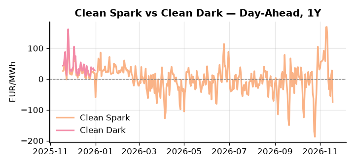
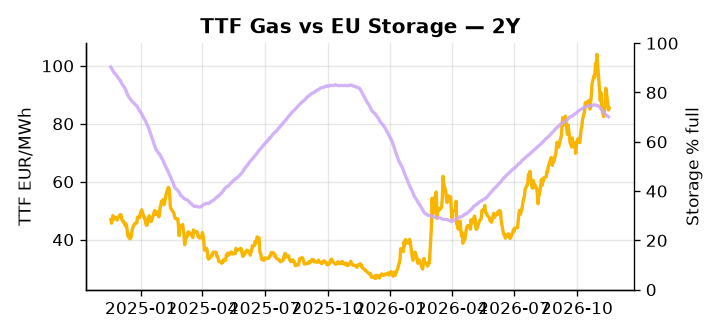

# European Cross-Commodity Risk Pack: Gas + Carbon → Power Curve Implications

**Daily desk brief — 2026-11-18**  
_Author: Sumer Sener · sumerberksener@gmail.com_  
_Generated by `scripts/generate_brief.py`. AI narrative + news themes via Anthropic Claude._

> **Data-freshness caveat:** Clean Dark (last 2025-12-31, 322d old); Coal (last 2025-12-26, 327d old). Numbers below should be read with this in mind.

## 1 · Executive summary

**TL;DR — GB Power at 93rd percentile (207 EUR/MWh) dominates; Clean Spark at 10th percentile signals coal totally out-of-merit amid high renewables and low carbon. Russian LNG ban from 2027 threatens TTF structural support.**

GB Power at 207 EUR/MWh (93rd percentile) is the dominant signal, reflecting acute island supply constraint that has extended the front-curve premium well beyond continental benchmarks, while a Clean Spark at −74.59 EUR/MWh (10th percentile) confirms coal is entirely stranded out-of-merit with zero economic dispatch headroom. EUA sits at 34.37 EUR/t (51st percentile), mid-range but anchored with a bullish policy lean as the EU Court's upholding of climate laws against Poland's legal challenges removes the legal overhang from the ETS framework, reinforcing the carbon-cost floor in the thermal merit order and accelerating the coal retirement pathway. EU storage at 70.15% — running 18 percentage points below its five-year seasonal — keeps gas tightness structural rather than episodic, with the Russian LNG ban effective 2027 compressing the medium-term refill window and competing against an elevated US storage surplus of 3,810 Bcf (+2% above average) for Atlantic LNG cargoes; with coal data 327 days old and clean dark spread 322 days old, thermal merit-order positioning and dark spread readings are indicative not bankable. With Russian LNG ban tail-risk reasserting as the dominant geopolitical driver, gas tightness pulling storage well below seasonal, EUA mid-range but policy-floor supported, and clean spark deeply out-of-the-money, the front-curve risk regime is one of compressed coal optionality and elevated renewable-shortfall sensitivity, where any cold snap or generation miss has no thermal backstop and no headroom before a violent merit-order flip.

_Generated by **claude-sonnet-4-6** via Anthropic API (two-pass extract→narrate). Prompts/responses logged to `ai/logs/`._
_Next-5d temperature anomaly — DE +2.7°C / FR +3.5°C / GB +1.8°C vs 5-yr seasonal normal (Open-Meteo)._

## 2 · Monitor metrics

**Primary (cross-commodity headline tiles)**

| Metric | As of | Latest | Unit | 1d Δ | 1w Δ | 5y pctile | Headline |
|---|---|---:|---|---:|---:|---:|---|
| TTF Gas | 2026-11-17 | 85.40 | EUR/MWh | +0.77% | +1.95% | 79 | Within typical range |
| EU Storage | 2026-11-16 | 70.15 | % full | -0.34% | -1.94% | 54 | 18.0 pp below the 5-yr seasonal average |
| EUA Carbon | 2026-11-17 | 34.37 | EUR/tCO2 | -0.35% | -0.46% | 51 | Within typical range |
| DE Power | 2026-11-18 | 108.86 | EUR/MWh | -48.55% | -37.99% | 58 | Within typical range |
| GB Power | 2026-11-18 | 207.20 | EUR/MWh | -8.52% | -12.71% | 93 | 93th-percentile of 5-yr range — historically high |
| Renewables | 2026-11-17 | 47.52 | % of load | -28.36% | +242.90% | 57 | Within typical range |
| Clean Spark | 2026-11-18 | -74.59 | EUR/MWh | -102.72 | -125.79 | 10 | 10th-percentile of 5-yr range — historically low |
| Clean Dark | 2025-12-31 (STALE) | 27.95 | EUR/MWh | -0.56 | +11.63 | 48 | Within typical range |

**Fundamentals inputs** _(feed derived metrics; not separately traded)_

| Metric | As of | Latest | Unit | 1d Δ | 1w Δ | 5y pctile | Headline |
|---|---|---:|---|---:|---:|---:|---|
| Coal | 2025-12-26 (STALE) | 96.00 | USD/t | -0.57% | +0.08% | 8 | 8th-percentile of 5-yr range — historically low |

_Spreads → abs EUR/MWh deltas; others → pct. Weekly Δ uses 5d trailing means. Full history in `data/<metric>.csv`._

## 3 · Gas + LNG arb

**TTF front-month** prints at 85.40 EUR/MWh — _Within typical range_.
**EU storage** at 70.2% full (-18.0 pp vs 5-yr seasonal avg) — _18.0 pp below the 5-yr seasonal average_.
**TTF − JKM (LNG arb)** at -0.76 EUR/MWh (JKM 27.77 USD/MMBtu) — JKM richer than TTF — Asia pulls cargoes, marginal European tightening risk.

## 4 · Carbon (EU ETS)

**EUA December** prints at 34.37 EUR/tCO2 — _Within typical range_. A euro of EUA adds ~0.37 EUR/MWh to gas-fired and ~0.85 EUR/MWh to coal-fired generation cost; strength compresses the dark spread faster than the spark.

**EU vs UK ETS** — Cobblestone's emissions desk trades EUA and UKA. Post-Brexit auction reform narrowed the UKA discount to EUA from £20+/t to single-digit £/t; CBAM phase-in pulls UK compliance demand toward parity. EUA−UKA basis remains a tradable cross-market signal.

**Supply / policy signal** — _EU Court upholds climate laws against Poland legal challenges; judicial credibility for ETS framework and coal retirement pathway reinforced._  
Side: `policy` · Polarity: `bullish EUA` · Source: Politico EU Energy

Judicial validation of EU climate framework removes legal overhang and supports EUA floor expectations; strengthens carbon-cost assumptions in thermal dispatch merit order and encourages retirement of coal-fired capacity.

_Surfaced from today's news flow by the AI extract pass (`ai/prompts/extract_v1.md` → `carbon_policy_signal`)._

## 5 · Power — Day-Ahead & curve

**DE day-ahead baseload** at 108.86 EUR/MWh — _Within typical range_.
**GB day-ahead baseload** at 207.20 EUR/MWh — _93th-percentile of 5-yr range — historically high_.
**DE − GB spread** at -98.34 EUR/MWh (GB premium) — drives interconnector flow direction.
**Cross-border net flows (Power Transportation):** DE↔FR -60.5 GWh (FR export); GB↔FR -73.6 GWh (FR export); NL↔DE -25.3 GWh (DE export).

**Clean spark spread** at -74.59 EUR/MWh — _10th-percentile of 5-yr range — historically low_. Bridge from gas + carbon fundamentals to gas-fired economics; sustained positive spark = TTF moves transmit directly into the power curve.

**Curve shape:** DA → W+1 → M+1 → Q+1 → Cal+1 → Cal+2 = 109 / 212 / 212 / 212 / 212 / 212 EUR/MWh — **Contango** (DA −Cal+1 spread -103 EUR/MWh). Forwards are seasonality projections — see Methodology.

{width=49%} {width=49%}

**This week ahead**

- **Wed** 09:00 UTC — EEX EUA primary auction (Mon–Thu daily; Wed is largest volume): Supply-side EUA signal; auction clearing relative to spot reads as ETS demand strength.
- **Wed** — ENTSO-E DE_LU + GB next-week wind/solar forecast refresh: Sets the residual-load curve a week out; outsized prints move power Cal+1 directionally.
- **Fri** 14:30 UTC — EIA weekly natural gas storage report: US storage trajectory anchors LNG export pricing into NW Europe — direct TTF transmission.
- **COP31** — COP31 final text — fossil, methane, electrification language: Outcome on EU electrification ambition and methane commitments will reset power demand and EUA curve expectations. Pragmatism signal already in flow; final text may soften or harden. _(news-extracted)_

**Scenarios (1w horizon)**

| | Summary | TTF | DE Power |
|---|---|---:|---:|
| **Base** | GB power elevated on island constraint; renewables volatile; coal out-of-merit persists. TTF range-bound; storage refill normal. | −1% to +2% | −5% to +3% |
| **Upside** | Cold snap drives heating demand, renewable shortfall forces coal back in merit. Russian LNG ban narrative accelerates. EUA rallies. | +5% to +12% | +8% to +18% |
| **Downside** | Sustained high renewables, mild weather, US LNG export surge via Atlantic arb suppresses TTF. GB demand destruction at 207 EUR/MWh. Coal stays stranded. | −3% to −8% | −10% to −20% |

_Illustrative, not forecasts. Magnitudes sized off historical sensitivity; AI-generated from today's extract pass._

## 6 · Today's themes

**Weather watch (next 7d)**
- **Storm · DE · Wed 18 – Thu 19 Nov** — peak gust 63 m/s (~225 km/h) on Wed 18 Nov. Wind generation likely surges Day 1, then risk of turbine cut-off if gusts exceed 25 m/s. Bearish DA early, sharp reversal possible. Watch DE-FR flow swings.
- **Storm · FR · Wed 18 – Fri 20 Nov** — peak gust 55 m/s (~198 km/h) on Fri 20 Nov. Strong wind boost to French generation; FR may export to neighbours. DA print likely below seasonal norm; watch FR-GB IFA flow toward GB.

**Watchlist (1–4 weeks)**
- COP31 final text on methane, electrification and fossil fuel language (outcome effect on EUA, power demand narrative)
- Russian LNG supply reroute to Asia (Jan 2027 onwards – monitor transatlantic LNG arb and TTF seasonality)

> **Cross-market regime tag:** Tight market: TTF rich vs history while storage runs below seasonal.

_Risk framing — built within a discipline of clear limits and continuous monitoring; observations here are framed as risk inputs, not directional calls. Positioning decisions remain with the desk._
_Methodology + sources: **README §Methodology**. Numbers auditable via the snapshot JSONs. Rule-based / informational — not investment advice._