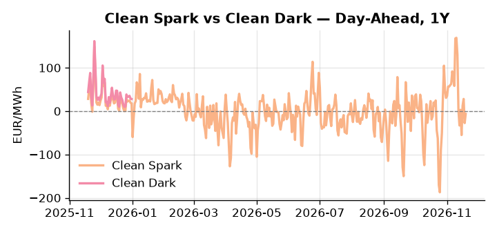
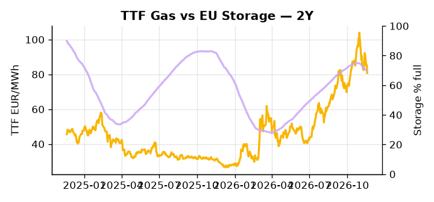

# European Cross-Commodity Risk Pack: Gas + Carbon → Power Curve Implications

**Daily desk brief — 2026-11-19**  
_Author: Sumer Sener · sumerberksener@gmail.com_  
_Generated by `scripts/generate_brief.py`. AI narrative + news themes via Anthropic Claude._

> **Data-freshness caveat:** Clean Dark (last 2025-12-31, 323d old); Coal (last 2025-12-26, 328d old). Numbers below should be read with this in mind.

## 1 · Executive summary

**TL;DR — Renewables at 95th-percentile suppress DA power; storage 18pp below seasonal normal tightens H2 outlook; Russia Arctic LNG ban from 2027 supports TTF via supply loss.**

Renewables running at the 95th percentile — covering 78.88% of load — are compressing day-ahead spreads to the floor, while European storage sitting 18 percentage points below the five-year seasonal norm at 69.95% keeps the medium-term gas picture unambiguously tight and refill urgency anchored into winter 2026–27. The Russia Arctic LNG ban from 2027, removing roughly 10% of global supply from EU reach and rerouting flows to Asia, structurally supports TTF and extends the front-month risk premium even as today's renewable flush provides temporary headroom. EUA sold off 4.54% yesterday — a 4.7-sigma move on COP31 stall — yet the carbon policy signal remains bullish-EUA: draft text signalling immediate fossil-fuel transition language, if finalized, would raise the marginal cost of unabated coal dispatch and support the EUA floor across the long curve. With coal data 328 days old and clean dark spreads 323 days stale, the dark spread is indicative not bankable, leaving the fuel-switch regime effectively dormant at coal's 8th-percentile read. Gas tightness anchored by below-seasonal storage AND EUA mid-range with bullish policy optionality AND clean spreads compressed by renewables leave the curve in a split regime — front-month artificially suppressed by the 95th-percentile renewable tail, while the Russia Arctic LNG sanctions timeline pulls Cal+1 risk wider and keeps fuel-switch headroom structurally in-the-money on any renewable reversion.

_Generated by **claude-sonnet-4-6** via Anthropic API (two-pass extract→narrate). Prompts/responses logged to `ai/logs/`._
_Next-5d temperature anomaly — DE +1.4°C / FR +2.2°C / GB +2.7°C vs 5-yr seasonal normal (Open-Meteo)._

## 2 · Monitor metrics

**Primary (cross-commodity headline tiles)**

| Metric | As of | Latest | Unit | 1d Δ | 1w Δ | 5y pctile | Headline |
|---|---|---:|---|---:|---:|---:|---|
| TTF Gas | 2026-11-18 | 80.85 | EUR/MWh | -5.33% | +0.94% | 77 | Within typical range |
| EU Storage | 2026-11-17 | 69.95 | % full | -0.29% | -1.78% | 54 | 18.0 pp below the 5-yr seasonal average |
| EUA Carbon | 2026-11-18 | 32.81 | EUR/tCO2 | -4.54% | -1.83% | 36 | outsized daily move (-4.54%, 4.7σ) |
| DE Power | 2026-11-19 | 167.53 | EUR/MWh | +14.55% | -29.93% | 81 | Within typical range |
| GB Power | 2026-11-19 | 180.82 | EUR/MWh | -23.52% | -5.49% | 86 | Within typical range |
| Renewables | 2026-11-18 | 78.88 | % of load | +65.98% | +125.67% | 95 | 95th-percentile of 5-yr range — historically high |
| Clean Spark | 2026-11-19 | -6.24 | EUR/MWh | +21.28 | -98.48 | 43 | Within typical range |
| Clean Dark | 2025-12-31 (STALE) | 27.95 | EUR/MWh | -0.56 | +11.63 | 48 | Within typical range |

**Fundamentals inputs** _(feed derived metrics; not separately traded)_

| Metric | As of | Latest | Unit | 1d Δ | 1w Δ | 5y pctile | Headline |
|---|---|---:|---|---:|---:|---:|---|
| Coal | 2025-12-26 (STALE) | 96.00 | USD/t | -0.57% | +0.08% | 8 | 8th-percentile of 5-yr range — historically low |

_Spreads → abs EUR/MWh deltas; others → pct. Weekly Δ uses 5d trailing means. Full history in `data/<metric>.csv`._

## 3 · Gas + LNG arb

**TTF front-month** prints at 80.85 EUR/MWh — _Within typical range_.
**EU storage** at 70.0% full (-18.0 pp vs 5-yr seasonal avg) — _18.0 pp below the 5-yr seasonal average_.
**TTF − JKM (LNG arb)** at -1.39 EUR/MWh (JKM 26.50 USD/MMBtu) — JKM richer than TTF — Asia pulls cargoes, marginal European tightening risk.

## 4 · Carbon (EU ETS)

**EUA December** prints at 32.81 EUR/tCO2 — _outsized daily move (-4.54%, 4.7σ)_. A euro of EUA adds ~0.37 EUR/MWh to gas-fired and ~0.85 EUR/MWh to coal-fired generation cost; strength compresses the dark spread faster than the spark.

**EU vs UK ETS** — Cobblestone's emissions desk trades EUA and UKA. Post-Brexit auction reform narrowed the UKA discount to EUA from £20+/t to single-digit £/t; CBAM phase-in pulls UK compliance demand toward parity. EUA−UKA basis remains a tradable cross-market signal.

**Supply / policy signal** — _COP31 draft text signals immediate fossil fuel transition language; final outcome will determine investor risk premium on legacy coal/gas power infrastructure and EUA long-curve pricing._  
Side: `policy` · Polarity: `bullish EUA` · Source: Politico EU Energy

If finalized with strong fossil-transition clause, heightens EU decarbonization credibility and raises marginal cost of unabated coal dispatch; supports EUA floor and accelerates power-to-renewable substitution merit-order shift.

_Surfaced from today's news flow by the AI extract pass (`ai/prompts/extract_v1.md` → `carbon_policy_signal`)._

## 5 · Power — Day-Ahead & curve

**DE day-ahead baseload** at 167.53 EUR/MWh — _Within typical range_.
**GB day-ahead baseload** at 180.82 EUR/MWh — _Within typical range_.
**DE − GB spread** at -13.29 EUR/MWh (GB premium) — drives interconnector flow direction.
**Cross-border net flows (Power Transportation):** DE↔FR -43.5 GWh (FR export); GB↔FR -71.9 GWh (FR export); NL↔DE -75.2 GWh (DE export).

**Clean spark spread** at -6.24 EUR/MWh — _Within typical range_. Bridge from gas + carbon fundamentals to gas-fired economics; sustained positive spark = TTF moves transmit directly into the power curve.

**Curve shape:** DA → W+1 → M+1 → Q+1 → Cal+1 → Cal+2 = 168 / 216 / 216 / 216 / 216 / 216 EUR/MWh — **Contango** (DA −Cal+1 spread -49 EUR/MWh). Forwards are seasonality projections — see Methodology.

{width=49%} {width=49%}

**This week ahead**

- **Fri** 14:30 UTC — EIA weekly natural gas storage report: US storage trajectory anchors LNG export pricing into NW Europe — direct TTF transmission.
- **Thu** 14:30 UTC — US EIA weekly crude inventories: Crude — and via crack spreads, refined-products — feed back into LNG arb economics.
- **Fri** — ENTSO-E weekly day-ahead volumes / system-balance summary: Reads the European generation mix in last 7d — confirms or breaks the Cal+1 thesis.
- **TBD** — COP31 fossil-fuel transition text finalization: EUA pricing inflection point; determines long-curve carbon cost assumption for power-dispatch models. _(news-extracted)_
- **TBD** — EU methane rule compliance roadmap release: If timeline accelerated, increases operational discipline on gas infrastructure; bears power-to-gas switching narrative. _(news-extracted)_

**Scenarios (1w horizon)**

| | Summary | TTF | DE Power |
|---|---|---:|---:|
| **Base** | Renewables sustain 90th+; storage drifts 1–2pp lower; TTF ranges 78–83 EUR/MWh. | ±1-3% | tracks |
| **Upside** | Cold front drives storage drawdown acceleration to 65%; renewables revert to 50th-pctile; LNG call lifts. TTF rallies on supply tightness. | +8-12% | +12-18% |
| **Downside** | Renewables sustain 95th; mild weather reduces storage drawdown; US LNG export surge widens arb. TTF softens on oversupply signal. | -6-10% | -8-14% |

_Illustrative, not forecasts. Magnitudes sized off historical sensitivity; AI-generated from today's extract pass._

## 6 · Today's themes

**Weather watch (next 7d)**
- **Storm · DE · Thu 19 Nov** — peak gust 47 m/s (~170 km/h) on Thu 19 Nov. Wind generation likely surges Day 1, then risk of turbine cut-off if gusts exceed 25 m/s. Bearish DA early, sharp reversal possible. Watch DE-FR flow swings.
- **Storm · FR · Thu 19 – Fri 20 Nov** — peak gust 54 m/s (~196 km/h) on Fri 20 Nov. Strong wind boost to French generation; FR may export to neighbours. DA print likely below seasonal norm; watch FR-GB IFA flow toward GB.

**Watchlist (1–4 weeks)**
- COP31 final text release and fossil fuel transition clause finalization
- EU methane rule implementation timeline; industry compliance roadmap

> **Cross-market regime tag:** Tight market: TTF rich vs history while storage runs below seasonal.

_Risk framing — built within a discipline of clear limits and continuous monitoring; observations here are framed as risk inputs, not directional calls. Positioning decisions remain with the desk._
_Methodology + sources: **README §Methodology**. Numbers auditable via the snapshot JSONs. Rule-based / informational — not investment advice._