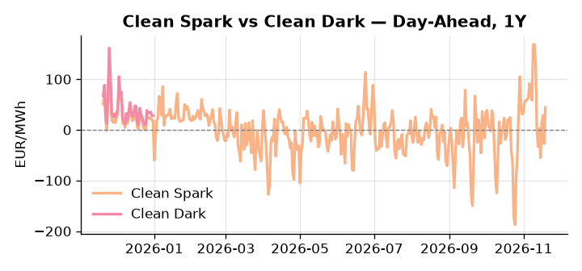
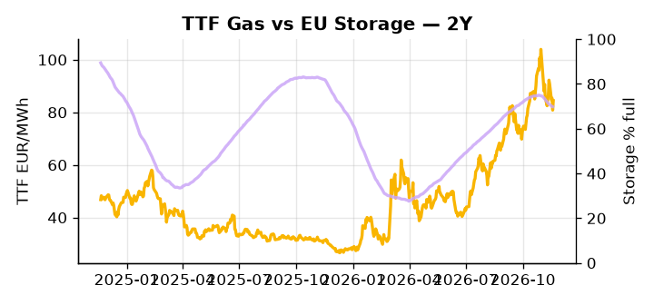

# European Cross-Commodity Risk Pack: Gas + Carbon → Power Curve Implications

**Daily desk brief — 2026-11-20**  
_Author: Sumer Sener · sumerberksener@gmail.com_  
_Generated by `scripts/generate_brief.py`. AI narrative + news themes via Anthropic Claude._

> **Data-freshness caveat:** Clean Dark (last 2025-12-31, 324d old); Coal (last 2025-12-26, 329d old). Numbers below should be read with this in mind.

## 1 · Executive summary

**TL;DR — Clean Spark at 93rd percentile signals sustained gas-in-the-money regime; EU storage 17.8 pp below seasonal average underpins structural thermal support, offset by delayed EU methane rules and COP31 fossil-fuel language softening.**

Clean Spark at the 93rd percentile (43.91 EUR/MWh) confirms the gas-in-the-money regime is firmly extended, underpinned by EU storage sitting 17.8 percentage points below seasonal average — a deficit that anchors the thermal call and keeps TTF structurally supported heading into winter. EUA, however, is printing at the 35th percentile and running at an extended -2.5σ deviation, as COP31 draft text weakens immediate fossil-fuel phase-out commitment and EU methane rules are delayed two years following US pressure, together repricing the structural decarbonisation compliance cost lower and softening the medium-term carbon floor. With coal and clean dark spread data 329 and 324 days old respectively, the dark spread is indicative not bankable, leaving the spark as the operative clean-spread signal. The 93rd-percentile spark alongside a -60.9 EUR/MWh monthly reversion flags elevated volatility and a mean-reversion tail risk that compresses near-term headroom even as the storage deficit sustains the broader thermal regime. Gas tightness AND carbon extended below mid-range on policy retreat AND clean spark in-the-money but volatile → with Russian sanctions escalation the dominant front-curve risk, the regime holds structurally supported on the front-month while Cal+1 steepness is capped by the bearish EUA policy reset.

_Generated by **claude-sonnet-4-6** via Anthropic API (two-pass extract→narrate). Prompts/responses logged to `ai/logs/`._
_Next-5d temperature anomaly — DE -0.3°C / FR +0.5°C / GB +0.1°C vs 5-yr seasonal normal (Open-Meteo)._

## 2 · Monitor metrics

**Primary (cross-commodity headline tiles)**

| Metric | As of | Latest | Unit | 1d Δ | 1w Δ | 5y pctile | Headline |
|---|---|---:|---|---:|---:|---:|---|
| TTF Gas | 2026-11-19 | 84.46 | EUR/MWh | +4.46% | -1.23% | 79 | Within typical range |
| EU Storage | 2026-11-18 | 69.83 | % full | -0.17% | -1.60% | 53 | 17.8 pp below the 5-yr seasonal average |
| EUA Carbon | 2026-11-19 | 32.64 | EUR/tCO2 | -0.52% | -3.70% | 35 | extended 2.5σ below the 50d trend |
| DE Power | 2026-11-19 | 224.83 | EUR/MWh | +53.73% | -25.26% | 89 | Within typical range |
| GB Power | 2026-11-20 | 181.07 | EUR/MWh | -7.99% | -9.24% | 86 | Within typical range |
| Renewables | 2026-11-19 | 39.56 | % of load | -49.85% | +70.20% | 39 | Within typical range |
| Clean Spark | 2026-11-19 | 43.91 | EUR/MWh | +71.43 | -88.45 | 93 | 93th-percentile of 5-yr range — historically high |
| Clean Dark | 2025-12-31 (STALE) | 27.95 | EUR/MWh | -0.56 | +11.63 | 48 | Within typical range |

**Fundamentals inputs** _(feed derived metrics; not separately traded)_

| Metric | As of | Latest | Unit | 1d Δ | 1w Δ | 5y pctile | Headline |
|---|---|---:|---|---:|---:|---:|---|
| Coal | 2025-12-26 (STALE) | 96.00 | USD/t | -0.57% | +0.08% | 8 | 8th-percentile of 5-yr range — historically low |

_Spreads → abs EUR/MWh deltas; others → pct. Weekly Δ uses 5d trailing means. Full history in `data/<metric>.csv`._

## 3 · Gas + LNG arb

**TTF front-month** prints at 84.46 EUR/MWh — _Within typical range_.
**EU storage** at 69.8% full (-17.8 pp vs 5-yr seasonal avg) — _17.8 pp below the 5-yr seasonal average_.
**TTF − JKM (LNG arb)** at -1.13 EUR/MWh (JKM 27.52 USD/MMBtu) — JKM richer than TTF — Asia pulls cargoes, marginal European tightening risk.

## 4 · Carbon (EU ETS)

**EUA December** prints at 32.64 EUR/tCO2 — _extended 2.5σ below the 50d trend_. A euro of EUA adds ~0.37 EUR/MWh to gas-fired and ~0.85 EUR/MWh to coal-fired generation cost; strength compresses the dark spread faster than the spark.

**EU vs UK ETS** — Cobblestone's emissions desk trades EUA and UKA. Post-Brexit auction reform narrowed the UKA discount to EUA from £20+/t to single-digit £/t; CBAM phase-in pulls UK compliance demand toward parity. EUA−UKA basis remains a tradable cross-market signal.

**Supply / policy signal** — _COP31 draft text signals weakening commitment to immediate fossil-fuel phase-out; EU methane rules delayed 2 years following US pressure campaign._  
Side: `policy` · Polarity: `bearish EUA` · Source: Politico EU Energy

Softened fossil-fuel language and methane-compliance deferrals reduce regulatory urgency for thermal-to-renewable fuel switching; structural EUA support weakens as market reprices lower decarbonization compliance cost.

_Surfaced from today's news flow by the AI extract pass (`ai/prompts/extract_v1.md` → `carbon_policy_signal`)._

## 5 · Power — Day-Ahead & curve

**DE day-ahead baseload** at 224.83 EUR/MWh — _Within typical range_.
**GB day-ahead baseload** at 181.07 EUR/MWh — _Within typical range_.
**DE − GB spread** at +43.76 EUR/MWh (DE premium) — drives interconnector flow direction.
**Cross-border net flows (Power Transportation):** DE↔FR -63.4 GWh (FR export); GB↔FR -73.6 GWh (FR export); NL↔DE -34.7 GWh (DE export).

**Clean spark spread** at +43.91 EUR/MWh — _93th-percentile of 5-yr range — historically high_. Bridge from gas + carbon fundamentals to gas-fired economics; sustained positive spark = TTF moves transmit directly into the power curve.

**Curve shape:** DA → W+1 → M+1 → Q+1 → Cal+1 → Cal+2 = 225 / 221 / 221 / 221 / 221 / 221 EUR/MWh — **Backwardation** (DA −Cal+1 spread +4 EUR/MWh). Forwards are seasonality projections — see Methodology.

{width=49%} {width=49%}

**This week ahead**

- **Fri** 14:30 UTC — EIA weekly natural gas storage report: US storage trajectory anchors LNG export pricing into NW Europe — direct TTF transmission.
- **Fri** — ENTSO-E weekly day-ahead volumes / system-balance summary: Reads the European generation mix in last 7d — confirms or breaks the Cal+1 thesis.
- **Tue** 08:00 UTC — AGSI+ daily storage print: First read on the week's gas injection / withdrawal pace; sets the tone for TTF curve shape.

**Scenarios (1w horizon)**

| | Summary | TTF | DE Power |
|---|---|---:|---:|
| **Base** | Gas in-the-money, storage deficit sustains thermal support; policy drift eases EUA upside. | +2-4% | tracks |
| **Upside** | Sanctions escalation on Russia isolates winter gas supply; EU refill pace misses seasonal; TTF reprices tighter. | +8-12% | +5-8% |
| **Downside** | COP31 fossil-fuel text finalizes with weak language; methane-rule delay signals policy retreat; EUA reprices lower. | -4-6% | -3-5% |

_Illustrative, not forecasts. Magnitudes sized off historical sensitivity; AI-generated from today's extract pass._

## 6 · Today's themes

**Weather watch (next 7d)**
- **Storm · FR · Fri 20 Nov** — peak gust 59 m/s (~212 km/h) on Fri 20 Nov. Strong wind boost to French generation; FR may export to neighbours. DA print likely below seasonal norm; watch FR-GB IFA flow toward GB.
- **Storm · DE · Sat 21 – Tue 24 Nov** — peak gust 44 m/s (~158 km/h) on Sat 21 Nov. Wind generation likely surges Day 1, then risk of turbine cut-off if gusts exceed 25 m/s. Bearish DA early, sharp reversal possible. Watch DE-FR flow swings.

**Watchlist (1–4 weeks)**
- COP31 final text conclusion (Antalya); outcome on fossil-fuel language carries EUA / power curve implications.
- UK-EU summit outcome: energy cooperation / trade reset; potential impact on GB-EU power interconnects and arbitrage.

> **Cross-market regime tag:** Tight market: TTF rich vs history while storage runs below seasonal.

_Risk framing — built within a discipline of clear limits and continuous monitoring; observations here are framed as risk inputs, not directional calls. Positioning decisions remain with the desk._
_Methodology + sources: **README §Methodology**. Numbers auditable via the snapshot JSONs. Rule-based / informational — not investment advice._