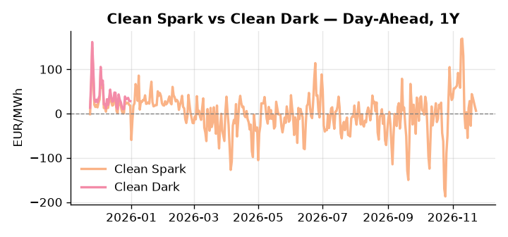
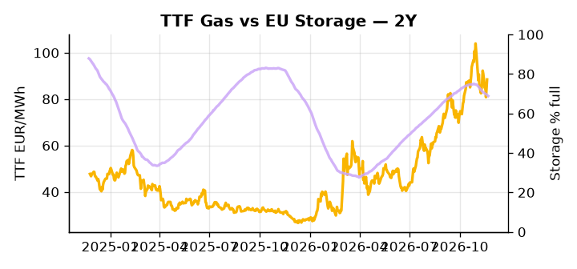

# European Cross-Commodity Risk Pack: Gas + Carbon → Power Curve Implications

**Daily desk brief — 2026-11-23**  
_Author: Sumer Sener · sumerberksener@gmail.com_  
_Generated by `scripts/generate_brief.py`. AI narrative + news themes via Anthropic Claude._

> **Data-freshness caveat:** Clean Dark (last 2025-12-31, 327d old); Coal (last 2025-12-26, 332d old). Numbers below should be read with this in mind.

## 1 · Executive summary

**TL;DR — GB Power at 92nd percentile amid storage -17.5pp below seasonal; EUA extended 2.3σ below trend as COP31 collapse signals weakened climate ambition and delayed EU methane rules.**

GB Power at the 92nd percentile (207.69 EUR/MWh) is the dominant signal, with EU storage running 17.5 percentage points below the five-year seasonal norm at 68.89% full — a structural tightness that sustains the cross-channel premium over DE Power (195 EUR/MWh, 85th percentile) and keeps LNG import reliance front and centre amid Russia sanctions escalation. EUA sits extended 2.3σ below its 50-day trend at 32.65 EUR/t (-5.14% on the week), with COP31's failure to secure a fossil fuel phase-out agreement and the two-year delay to EU methane reporting rules — pushed under US pressure — both acting as bearish-policy headwinds that weaken medium-term ETS demand and pressure the Cal+1 decarbonisation premium. Renewable share collapsed 45% in a single day to the 21st percentile, opening a thermal call window that is currently anchored by coal data 332 days stale and clean dark spreads 327 days stale, so dispatch margin assessment remains indicative not bankable. With Russia sanctions escalation reasserting geopolitical risk on TTF, gas tightness AND carbon extended below trend on weakened climate stringency AND clean spreads compressed by stale coal inputs keep the front-curve risk wide while the Cal+1 regime drifts bearish on EUA — leaving the curve in a split regime of elevated near-term power premiums and structurally headroom-eroding carbon policy retreat.

_Generated by **claude-sonnet-4-6** via Anthropic API (two-pass extract→narrate). Prompts/responses logged to `ai/logs/`._
_Next-5d temperature anomaly — DE -2.5°C / FR -2.9°C / GB -1.9°C vs 5-yr seasonal normal (Open-Meteo)._

## 2 · Monitor metrics

**Primary (cross-commodity headline tiles)**

| Metric | As of | Latest | Unit | 1d Δ | 1w Δ | 5y pctile | Headline |
|---|---|---:|---|---:|---:|---:|---|
| TTF Gas | 2026-11-20 | 88.45 | EUR/MWh | +4.73% | -3.02% | 81 | Within typical range |
| EU Storage | 2026-11-22 | 68.89 | % full | -0.38% | -1.43% | 52 | 17.5 pp below the 5-yr seasonal average |
| EUA Carbon | 2026-11-20 | 32.65 | EUR/tCO2 | +0.03% | -5.14% | 35 | extended 2.3σ below the 50d trend |
| DE Power | 2026-11-23 | 195.00 | EUR/MWh | -4.45% | +9.98% | 85 | Within typical range |
| GB Power | 2026-11-23 | 207.69 | EUR/MWh | -4.53% | -7.87% | 92 | 92th-percentile of 5-yr range — historically high |
| Renewables | 2026-11-22 | 30.63 | % of load | -45.09% | -18.82% | 21 | Within typical range |
| Clean Spark | 2026-11-23 | 6.08 | EUR/MWh | -9.08 | +26.62 | 58 | Within typical range |
| Clean Dark | 2025-12-31 (STALE) | 27.95 | EUR/MWh | -0.56 | +11.63 | 48 | Within typical range |

**Fundamentals inputs** _(feed derived metrics; not separately traded)_

| Metric | As of | Latest | Unit | 1d Δ | 1w Δ | 5y pctile | Headline |
|---|---|---:|---|---:|---:|---:|---|
| Coal | 2025-12-26 (STALE) | 96.00 | USD/t | -0.57% | +0.08% | 8 | 8th-percentile of 5-yr range — historically low |

_Spreads → abs EUR/MWh deltas; others → pct. Weekly Δ uses 5d trailing means. Full history in `data/<metric>.csv`._

## 3 · Gas + LNG arb

**TTF front-month** prints at 88.45 EUR/MWh — _Within typical range_.
**EU storage** at 68.9% full (-17.5 pp vs 5-yr seasonal avg) — _17.5 pp below the 5-yr seasonal average_.
**TTF − JKM (LNG arb)** at +0.07 EUR/MWh (JKM 28.42 USD/MMBtu) — TTF richer than JKM — LNG cargoes favour Europe.

## 4 · Carbon (EU ETS)

**EUA December** prints at 32.65 EUR/tCO2 — _extended 2.3σ below the 50d trend_. A euro of EUA adds ~0.37 EUR/MWh to gas-fired and ~0.85 EUR/MWh to coal-fired generation cost; strength compresses the dark spread faster than the spark.

**EU vs UK ETS** — Cobblestone's emissions desk trades EUA and UKA. Post-Brexit auction reform narrowed the UKA discount to EUA from £20+/t to single-digit £/t; CBAM phase-in pulls UK compliance demand toward parity. EUA−UKA basis remains a tradable cross-market signal.

**Supply / policy signal** — _EU methane reporting rules delayed two years under US pressure; COP31 climate talks collapse without fossil fuel phase-out agreement._  
Side: `policy` · Polarity: `bearish EUA` · Source: Politico EU Energy

Delay weakens EU climate stringency and signals global fossil fuel phase-out ambition failure. Reduces long-term demand destruction for gas and coal, pressuring EUA forward curve into 2027.

_Surfaced from today's news flow by the AI extract pass (`ai/prompts/extract_v1.md` → `carbon_policy_signal`)._

## 5 · Power — Day-Ahead & curve

**DE day-ahead baseload** at 195.00 EUR/MWh — _Within typical range_.
**GB day-ahead baseload** at 207.69 EUR/MWh — _92th-percentile of 5-yr range — historically high_.
**DE − GB spread** at -12.69 EUR/MWh (GB premium) — drives interconnector flow direction.
**Cross-border net flows (Power Transportation):** DE↔FR -38.9 GWh (FR export); GB↔FR -73.3 GWh (FR export); NL↔DE -80.7 GWh (DE export).

**Clean spark spread** at +6.08 EUR/MWh — _Within typical range_. Bridge from gas + carbon fundamentals to gas-fired economics; sustained positive spark = TTF moves transmit directly into the power curve.

**Curve shape:** DA → W+1 → M+1 → Q+1 → Cal+1 → Cal+2 = 195 / 229 / 229 / 229 / 229 / 229 EUR/MWh — **Contango** (DA −Cal+1 spread -34 EUR/MWh). Forwards are seasonality projections — see Methodology.

{width=49%} {width=49%}

**This week ahead**

- **Tue** 08:00 UTC — AGSI+ daily storage print: First read on the week's gas injection / withdrawal pace; sets the tone for TTF curve shape.
- **Wed** 09:00 UTC — EEX EUA primary auction (Mon–Thu daily; Wed is largest volume): Supply-side EUA signal; auction clearing relative to spot reads as ETS demand strength.
- **Wed** — ENTSO-E DE_LU + GB next-week wind/solar forecast refresh: Sets the residual-load curve a week out; outsized prints move power Cal+1 directionally.
- **TBD** — COP31 fossil fuel re-negotiation timeline announced: Failed phase-out agreement leaves window for revised commitment; timing and binding language will set EUA curve repricing trajectory into 2027. _(news-extracted)_
- **TBD** — EU methane rules finalized detail — January 2027 delay confirmation: Confirms two-year delay; allows market to price in longer-cycle gas support and reduced climate stringency drag on power spreads. _(news-extracted)_

**Scenarios (1w horizon)**

| | Summary | TTF | DE Power |
|---|---|---:|---:|
| **Base** | Tight storage backdrop persists; GB Power holds elevated premium; EUA consolidates near 32.5 EUR/tCO2 pending methane rule detail. | ±1-3% | tracks |
| **Upside** | Cold front or additional Russia sanctions escalation; thermal dispatch extends; storage refill pace slows. TTF and GB Power rally on heating demand spike. | +5-8% | +3-5% |
| **Downside** | Milder-than-normal weather or wind recovery lifts renewables; EUA decline extends on policy uncertainty confirmation; thermal call fades. Power spreads compress. | -4-6% | -5-8% |

_Illustrative, not forecasts. Magnitudes sized off historical sensitivity; AI-generated from today's extract pass._

## 6 · Today's themes

**Weather watch (next 7d)**
- **Storm · DE · Mon 23 – Sun 29 Nov** — peak gust 39 m/s (~140 km/h) on Mon 23 Nov. Wind generation likely surges Day 1, then risk of turbine cut-off if gusts exceed 25 m/s. Bearish DA early, sharp reversal possible. Watch DE-FR flow swings.
- **Storm · GB · Tue 24 – Thu 26 Nov** — peak gust 41 m/s (~147 km/h) on Wed 25 Nov. GB wind capacity is large — DA likely soft. Cut-off risk if gusts exceed safety thresholds; opposite tail (sudden tightening) possible.

**Watchlist (1–4 weeks)**
- EU-UK energy cooperation outcomes from recent summit; potential North Sea coordination.
- COP31 final outcome and any binding fossil fuel language re-negotiation timeline.

> **Cross-market regime tag:** Tight market: TTF rich vs history while storage runs below seasonal.

_Risk framing — built within a discipline of clear limits and continuous monitoring; observations here are framed as risk inputs, not directional calls. Positioning decisions remain with the desk._
_Methodology + sources: **README §Methodology**. Numbers auditable via the snapshot JSONs. Rule-based / informational — not investment advice._