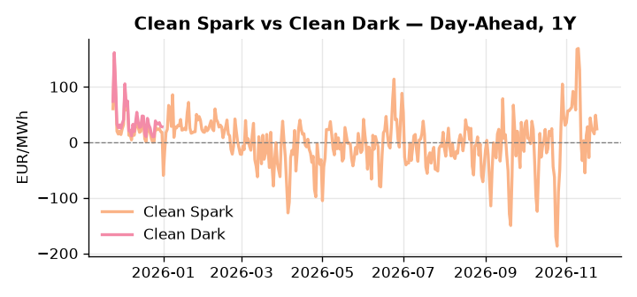
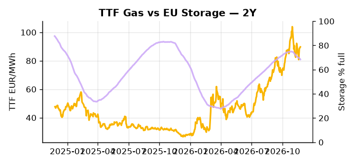

# European Cross-Commodity Risk Pack: Gas + Carbon → Power Curve Implications

**Daily desk brief — 2026-11-24**  
_Author: Sumer Sener · sumerberksener@gmail.com_  
_Generated by `scripts/generate_brief.py`. AI narrative + news themes via Anthropic Claude._

> **Data-freshness caveat:** Clean Dark (last 2025-12-31, 328d old); Coal (last 2025-12-26, 333d old). Numbers below should be read with this in mind.

## 1 · Executive summary

**TL;DR — GB power 92nd-percentile amid storage deficit 17.7pp below seasonal; coal at 8th-percentile signals tight thermal economics and fuel-switch regime despite stale coal data.**

GB power extended to the 92nd percentile at 212.34 EUR/MWh, with EU storage sitting 17.7 percentage points below seasonal at 68.41%, forcing sustained thermal dispatch into the core winter window and anchoring the front-month power regime firmly in the 85–95th-percentile band. Coal at the 8th percentile (96 USD/t) signals structurally cheap thermal fuel and a potential fuel-switch dynamic, though with coal data 333 days stale and the clean dark spread 328 days stale, the thermal merit-order read is indicative not bankable and the desk should treat fuel-switch breakeven levels with caution until a data refresh is in hand. Renewable share collapsed to the 18th percentile at 29.51% of load — down 38.69% week-on-week — keeping the thermal call elevated, while US LNG inventory at 3,810 Bcf (+2% on the five-year average) suppresses TTF arbitrage and caps front-month gas upside despite the storage shortfall. EUA at 32.99 EUR/t (37th percentile) sits in compressed mid-range as EU methane-reporting delays driven by Trump-administration lobbying and the COP31 fossil phase-out collapse weaken near-term regulatory enforcement urgency, a structurally bearish policy overhang that caps allowance upside and supports thermal-dispatch margins over the medium term. With gas tightness anchored by a 17.7pp storage deficit, carbon headroom capped by policy signal deterioration, and clean spreads indicative rather than bankable pending data refresh, the curve regime is one of extended front-curve thermal dominance — with the COP31 collapse removing a key enforcement backstop that would otherwise compress Cal+1 dark spread headroom.

_Generated by **claude-sonnet-4-6** via Anthropic API (two-pass extract→narrate). Prompts/responses logged to `ai/logs/`._
_Next-5d temperature anomaly — DE -3.3°C / FR -3.5°C / GB -1.0°C vs 5-yr seasonal normal (Open-Meteo)._

## 2 · Monitor metrics

**Primary (cross-commodity headline tiles)**

| Metric | As of | Latest | Unit | 1d Δ | 1w Δ | 5y pctile | Headline |
|---|---|---:|---|---:|---:|---:|---|
| TTF Gas | 2026-11-23 | 89.74 | EUR/MWh | +1.45% | -2.38% | 81 | Within typical range |
| EU Storage | 2026-11-23 | 68.41 | % full | -0.73% | -1.58% | 51 | 17.7 pp below the 5-yr seasonal average |
| EUA Carbon | 2026-11-23 | 32.99 | EUR/tCO2 | +1.04% | -5.70% | 37 | Within typical range |
| DE Power | 2026-11-24 | 215.72 | EUR/MWh | -10.27% | +23.58% | 88 | Within typical range |
| GB Power | 2026-11-24 | 212.34 | EUR/MWh | -8.95% | -2.68% | 92 | 92th-percentile of 5-yr range — historically high |
| Renewables | 2026-11-23 | 29.51 | % of load | -3.67% | -38.69% | 18 | Within typical range |
| Clean Spark | 2026-11-24 | 24.11 | EUR/MWh | -24.70 | +42.05 | 82 | Within typical range |
| Clean Dark | 2025-12-31 (STALE) | 27.95 | EUR/MWh | -0.56 | +11.63 | 48 | Within typical range |

**Fundamentals inputs** _(feed derived metrics; not separately traded)_

| Metric | As of | Latest | Unit | 1d Δ | 1w Δ | 5y pctile | Headline |
|---|---|---:|---|---:|---:|---:|---|
| Coal | 2025-12-26 (STALE) | 96.00 | USD/t | -0.57% | +0.08% | 8 | 8th-percentile of 5-yr range — historically low |

_Spreads → abs EUR/MWh deltas; others → pct. Weekly Δ uses 5d trailing means. Full history in `data/<metric>.csv`._

## 3 · Gas + LNG arb

**TTF front-month** prints at 89.74 EUR/MWh — _Within typical range_.
**EU storage** at 68.4% full (-17.7 pp vs 5-yr seasonal avg) — _17.7 pp below the 5-yr seasonal average_.
**TTF − JKM (LNG arb)** at +0.67 EUR/MWh (JKM 28.64 USD/MMBtu) — TTF richer than JKM — LNG cargoes favour Europe.

## 4 · Carbon (EU ETS)

**EUA December** prints at 32.99 EUR/tCO2 — _Within typical range_. A euro of EUA adds ~0.37 EUR/MWh to gas-fired and ~0.85 EUR/MWh to coal-fired generation cost; strength compresses the dark spread faster than the spark.

**EU vs UK ETS** — Cobblestone's emissions desk trades EUA and UKA. Post-Brexit auction reform narrowed the UKA discount to EUA from £20+/t to single-digit £/t; CBAM phase-in pulls UK compliance demand toward parity. EUA−UKA basis remains a tradable cross-market signal.

**Supply / policy signal** — _EU methane emissions reporting for fossil fuels delayed by Trump-administration lobbying; COP31 fossil phase-out collapse weakens global climate consensus and long-term EU ETS enforcement urgency._  
Side: `policy` · Polarity: `bearish EUA` · Source: Politico EU Energy

Delay reduces near-term regulatory pressure on fossil-fuel operators to invest in abatement and fuel-switching; weakens medium-term demand for carbon allowances and power-generation decarbonization, capping EUA upside and supporting thermal-dispatch margins.

_Surfaced from today's news flow by the AI extract pass (`ai/prompts/extract_v1.md` → `carbon_policy_signal`)._

## 5 · Power — Day-Ahead & curve

**DE day-ahead baseload** at 215.72 EUR/MWh — _Within typical range_.
**GB day-ahead baseload** at 212.34 EUR/MWh — _92th-percentile of 5-yr range — historically high_.
**DE − GB spread** at +3.38 EUR/MWh (DE premium) — drives interconnector flow direction.
**Cross-border net flows (Power Transportation):** DE↔FR -28.3 GWh (FR export); GB↔FR -35.3 GWh (FR export); NL↔DE -40.1 GWh (DE export).

**Clean spark spread** at +24.11 EUR/MWh — _Within typical range_. Bridge from gas + carbon fundamentals to gas-fired economics; sustained positive spark = TTF moves transmit directly into the power curve.

**Curve shape:** DA → W+1 → M+1 → Q+1 → Cal+1 → Cal+2 = 216 / 235 / 235 / 235 / 235 / 235 EUR/MWh — **Contango** (DA −Cal+1 spread -19 EUR/MWh). Forwards are seasonality projections — see Methodology.

{width=49%} {width=49%}

**This week ahead**

- **Tue** 08:00 UTC — AGSI+ daily storage print: First read on the week's gas injection / withdrawal pace; sets the tone for TTF curve shape.
- **Wed** 09:00 UTC — EEX EUA primary auction (Mon–Thu daily; Wed is largest volume): Supply-side EUA signal; auction clearing relative to spot reads as ETS demand strength.
- **Wed** — ENTSO-E DE_LU + GB next-week wind/solar forecast refresh: Sets the residual-load curve a week out; outsized prints move power Cal+1 directionally.

**Scenarios (1w horizon)**

| | Summary | TTF | DE Power |
|---|---|---:|---:|
| **Base** | Storage deficit sustains 70+ TTF and 80–95th-percentile power; renewables remain depressed; coal cheap but merit-order opaque pending data refresh. | ±1-3% | −2-4% |
| **Upside** | Cold front + wind drought extend renewable deficit into Dec; storage drain accelerates to 1pp/day; thermal runs hard, TTF rallies into supply-tight regime. | +8-12% | +5-8% |
| **Downside** | Mild weather + wind recovery lift renewable share to 40th-pctile; US LNG export surge to Europe floods arbitrage window; storage refill catches up to seasonal. | −6-10% | −8-12% |

_Illustrative, not forecasts. Magnitudes sized off historical sensitivity; AI-generated from today's extract pass._

## 6 · Today's themes

**Weather watch (next 7d)**
- **Storm · GB · Tue 24 – Sat 28 Nov** — peak gust 38 m/s (~138 km/h) on Wed 25 Nov. GB wind capacity is large — DA likely soft. Cut-off risk if gusts exceed safety thresholds; opposite tail (sudden tightening) possible.
- **Cold snap · DE · Thu 26 – Mon 30 Nov** — peak -7.0°C vs normal. Bullish DE power and TTF — heating demand pulls thermal plant up the merit order. Spark spread expands; watch DE−GB spread widen on the DE side.

**Watchlist (1–4 weeks)**
- EU budget vote (Patriots for Europe revolt risk); timeline unclear but could delay green-funding allocations.
- UK-EU summit outcomes on energy/trade alignment; implications for GB power price decoupling.

> **Cross-market regime tag:** Tight market: TTF rich vs history while storage runs below seasonal.

_Risk framing — built within a discipline of clear limits and continuous monitoring; observations here are framed as risk inputs, not directional calls. Positioning decisions remain with the desk._
_Methodology + sources: **README §Methodology**. Numbers auditable via the snapshot JSONs. Rule-based / informational — not investment advice._