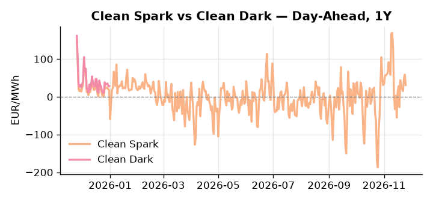
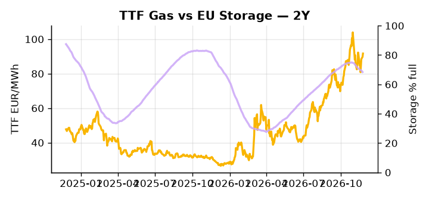

# European Cross-Commodity Risk Pack: Gas + Carbon → Power Curve Implications

**Daily desk brief — 2026-11-25**  
_Author: Sumer Sener · sumerberksener@gmail.com_  
_Generated by `scripts/generate_brief.py`. AI narrative + news themes via Anthropic Claude._

> **Data-freshness caveat:** Clean Dark (last 2025-12-31, 329d old); Coal (last 2025-12-26, 334d old). Numbers below should be read with this in mind.

## 1 · Executive summary

**TL;DR — Renewables at 9th-percentile crush merit order; GB power 91st-percentile signals tight interconnect; storage 17.7pp below seasonal average threatens H2 refill pace amid stalled climate policy.**

Renewable output at the 9th percentile is forcing coal and gas deep into the merit order, with EU storage sitting 17.7 percentage points below its five-year seasonal average at 68.4% full and TTF anchored at the 82nd percentile (91.67 EUR/MWh), leaving the system with compressed headroom against any cold-snap or supply disruption. GB power at 206.75 EUR/MWh (91st percentile) and DE at 226.53 EUR/MWh (89th percentile) signal a tight interconnect regime with limited arbitrage slack, while the narrow GB-DE spread keeps cross-border flows exposed to any stability shift. EUA at the 38th percentile is already under pressure, down 6% week-on-week, as the COP31 collapse weakens near-term enforcement risk and upcoming EU ETS auctions Wednesday-Thursday will test whether the carbon floor holds above 30 EUR/t or slides further as reduced regulatory urgency lifts coal marginal cost economics back into dispatch. With coal and clean-dark data 329–334 days old, the dark spread is indicative not bankable, but the directional read of thermal in-the-money dispatch remains consistent with current live metrics. With Ukraine peace-talk risk resetting TTF's geopolitical premium into the weekend, gas tightness at the 82nd percentile AND carbon sliding toward a bearish-EUA regime AND clean spreads in-the-money on thermal dispatch pull front-curve risk wider while the Cal+1 regime awaits confirmation of storage refill pace through spring.

_Generated by **claude-sonnet-4-6** via Anthropic API (two-pass extract→narrate). Prompts/responses logged to `ai/logs/`._
_Next-5d temperature anomaly — DE -4.0°C / FR -3.5°C / GB -1.2°C vs 5-yr seasonal normal (Open-Meteo)._

## 2 · Monitor metrics

**Primary (cross-commodity headline tiles)**

| Metric | As of | Latest | Unit | 1d Δ | 1w Δ | 5y pctile | Headline |
|---|---|---:|---|---:|---:|---:|---|
| TTF Gas | 2026-11-24 | 91.67 | EUR/MWh | +2.15% | -1.10% | 82 | Within typical range |
| EU Storage | 2026-11-23 | 68.40 | % full | -0.73% | -1.58% | 51 | 17.7 pp below the 5-yr seasonal average |
| EUA Carbon | 2026-11-24 | 33.10 | EUR/tCO2 | +0.34% | -6.02% | 38 | Within typical range |
| DE Power | 2026-11-25 | 226.53 | EUR/MWh | -10.87% | +24.31% | 89 | Within typical range |
| GB Power | 2026-11-25 | 206.75 | EUR/MWh | -13.03% | +0.39% | 91 | 91th-percentile of 5-yr range — historically high |
| Renewables | 2026-11-24 | 21.01 | % of load | -28.79% | -42.96% | 9 | 9th-percentile of 5-yr range — historically low |
| Clean Spark | 2026-11-25 | 31.01 | EUR/MWh | -27.62 | +35.49 | 88 | Within typical range |
| Clean Dark | 2025-12-31 (STALE) | 27.95 | EUR/MWh | -0.56 | +11.63 | 48 | Within typical range |

**Fundamentals inputs** _(feed derived metrics; not separately traded)_

| Metric | As of | Latest | Unit | 1d Δ | 1w Δ | 5y pctile | Headline |
|---|---|---:|---|---:|---:|---:|---|
| Coal | 2025-12-26 (STALE) | 96.00 | USD/t | -0.57% | +0.08% | 8 | 8th-percentile of 5-yr range — historically low |

_Spreads → abs EUR/MWh deltas; others → pct. Weekly Δ uses 5d trailing means. Full history in `data/<metric>.csv`._

## 3 · Gas + LNG arb

**TTF front-month** prints at 91.67 EUR/MWh — _Within typical range_.
**EU storage** at 68.4% full (-17.7 pp vs 5-yr seasonal avg) — _17.7 pp below the 5-yr seasonal average_.
**TTF − JKM (LNG arb)** at +1.55 EUR/MWh (JKM 28.81 USD/MMBtu) — TTF richer than JKM — LNG cargoes favour Europe.

## 4 · Carbon (EU ETS)

**EUA December** prints at 33.10 EUR/tCO2 — _Within typical range_. A euro of EUA adds ~0.37 EUR/MWh to gas-fired and ~0.85 EUR/MWh to coal-fired generation cost; strength compresses the dark spread faster than the spark.

**EU vs UK ETS** — Cobblestone's emissions desk trades EUA and UKA. Post-Brexit auction reform narrowed the UKA discount to EUA from £20+/t to single-digit £/t; CBAM phase-in pulls UK compliance demand toward parity. EUA−UKA basis remains a tradable cross-market signal.

**Supply / policy signal** — _COP31 collapse weakens international fossil-fuel commitments; EU ETS auction outcomes on Wed–Thu will test whether carbon price holds above 30 EUR/tCO2 or slides on reduced regulatory pressure._  
Side: `policy` · Polarity: `bearish EUA` · Source: Politico EU Energy

Failed climate accord reduces enforcement risk and near-term decarbonization urgency; weaker carbon floor supports coal marginal cost economics and pressures EUA into seasonal winter trough, lifting thermal dispatch.

_Surfaced from today's news flow by the AI extract pass (`ai/prompts/extract_v1.md` → `carbon_policy_signal`)._

## 5 · Power — Day-Ahead & curve

**DE day-ahead baseload** at 226.53 EUR/MWh — _Within typical range_.
**GB day-ahead baseload** at 206.75 EUR/MWh — _91th-percentile of 5-yr range — historically high_.
**DE − GB spread** at +19.78 EUR/MWh (DE premium) — drives interconnector flow direction.
**Cross-border net flows (Power Transportation):** DE↔FR -55.6 GWh (FR export); GB↔FR +20.5 GWh (GB export); NL↔DE +72.8 GWh (NL export).

**Clean spark spread** at +31.01 EUR/MWh — _Within typical range_. Bridge from gas + carbon fundamentals to gas-fired economics; sustained positive spark = TTF moves transmit directly into the power curve.

**Curve shape:** DA → W+1 → M+1 → Q+1 → Cal+1 → Cal+2 = 227 / 237 / 237 / 237 / 237 / 237 EUR/MWh — **Contango** (DA −Cal+1 spread -11 EUR/MWh). Forwards are seasonality projections — see Methodology.

{width=49%} {width=49%}

**This week ahead**

- **Wed** 09:00 UTC — EEX EUA primary auction (Mon–Thu daily; Wed is largest volume): Supply-side EUA signal; auction clearing relative to spot reads as ETS demand strength.
- **Wed** — ENTSO-E DE_LU + GB next-week wind/solar forecast refresh: Sets the residual-load curve a week out; outsized prints move power Cal+1 directionally.
- **Fri** 14:30 UTC — EIA weekly natural gas storage report: US storage trajectory anchors LNG export pricing into NW Europe — direct TTF transmission.
- **Wed** — EU ETS auctions (Phase 4): COP31 collapse likely to depress bid tone; carbon price reaction tests 30-32 EUR/tCO2 support. _(news-extracted)_
- **Fri** — Ukraine peace-talk update: VdL energy-ceasefire signal; any escalation risk reset lifts TTF geopolitical premium into weekend. _(news-extracted)_

**Scenarios (1w horizon)**

| | Summary | TTF | DE Power |
|---|---|---:|---:|
| **Base** | Renewables recover modestly; storage injection pace normalizes; thermal dispatch gradually eases as wind/solar mean-revert. | −2% to +3% | −5% to +2% |
| **Upside** | Renewable forecast worsens (wind cuts deepen); storage injection stalls; cold snap drives space-heating demand; EUA regulatory cliff triggers coal recall surge. | +5% to +12% | +8% to +15% |
| **Downside** | Wind output recovers sharply; mild weather eases heating load; US LNG supply glut depresses arbitrage; EUA stays sub-32 EUR/tCO2 — coal uncompetitive. | −8% to −4% | −12% to −6% |

_Illustrative, not forecasts. Magnitudes sized off historical sensitivity; AI-generated from today's extract pass._

## 6 · Today's themes

**Weather watch (next 7d)**
- **Storm · GB · Wed 25 – Sat 28 Nov** — peak gust 38 m/s (~138 km/h) on Wed 25 Nov. GB wind capacity is large — DA likely soft. Cut-off risk if gusts exceed safety thresholds; opposite tail (sudden tightening) possible.
- **Cold snap · DE · Thu 26 – Mon 30 Nov** — peak -6.1°C vs normal. Bullish DE power and TTF — heating demand pulls thermal plant up the merit order. Spark spread expands; watch DE−GB spread widen on the DE side.

**Watchlist (1–4 weeks)**
- Ukraine peace negotiations; track VdL signals on energy ceasefire mechanics and timing.
- EU ETS auction outcomes; monitor carbon price reaction to COP31 collapse and green-permitting policy mix.

> **Cross-market regime tag:** Tight market: TTF rich vs history while storage runs below seasonal.

_Risk framing — built within a discipline of clear limits and continuous monitoring; observations here are framed as risk inputs, not directional calls. Positioning decisions remain with the desk._
_Methodology + sources: **README §Methodology**. Numbers auditable via the snapshot JSONs. Rule-based / informational — not investment advice._