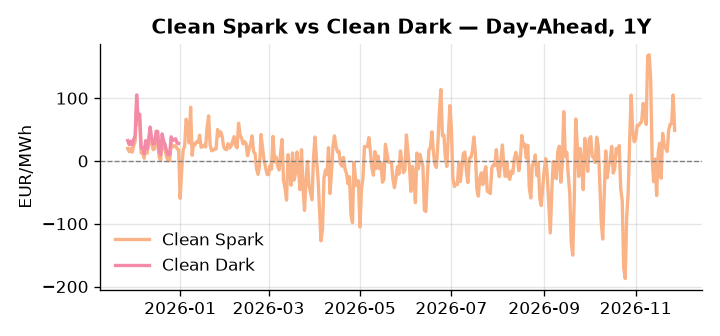
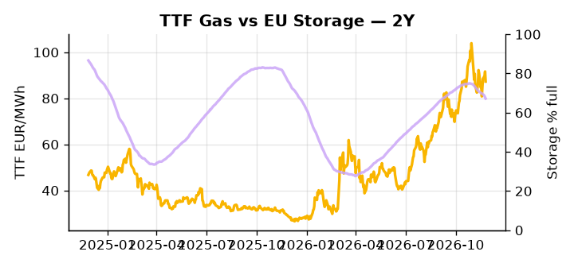

# European Cross-Commodity Risk Pack: Gas + Carbon → Power Curve Implications

**Daily desk brief — 2026-11-27**  
_Author: Sumer Sener · sumerberksener@gmail.com_  
_Generated by `scripts/generate_brief.py`. AI narrative + news themes via Anthropic Claude._

> **Data-freshness caveat:** Clean Dark (last 2025-12-31, 331d old); Coal (last 2025-12-26, 336d old). Numbers below should be read with this in mind.

## 1 · Executive summary

**TL;DR — Clean Spark at 94th percentile signals sustained gas-in-the-money; storage 18.2pp below seasonal norm pressures winter refill; Spain election (Nov 29) threatens EU renewable deployment via climate-skeptic pivot.**

Clean Spark at the 94th percentile (48.75 EUR/MWh) is the dominant signal: gas remains firmly in-the-money, with storage at 67.2% — 18.2 percentage points below seasonal norm — anchoring thermal dispatch as the winter merit-order default and leaving headroom for a sustained refill squeeze. Renewables at the 24th percentile offer no relief, reinforcing the tight thermal regime and keeping front-month power elevated; DE Power sits at the 90th percentile despite a sharp -19.3% daily move, while GB Power is at the 90th percentile after -22.8% — both still extended on a structural basis. With coal data 336 days old and clean dark 331 days stale, the dark spread is indicative not bankable, and the clean spark reading carries the full evidential weight. EUA policy context adds a conflicted signal: faster EU permitting for gas peakers raises thermal supply flexibility, while the Spain PP-Vox climate-skeptic pivot post-November 29 risks slowing Iberian renewable deployment and lifting EUA floor pressure if thermal intensity rises — net policy polarity neutral but watch Iberian spreads for the first read-through. With Ukraine energy ceasefire language active in peace talks, gas tightness AND EUA policy conflict AND clean spark in-the-money keep the front-curve risk premium extended, while any formalised Russian gas truce stripping 5–15 points of war premium from TTF remains the singular event that could collapse the current Cal+1 regime.

_Generated by **claude-sonnet-4-6** via Anthropic API (two-pass extract→narrate). Prompts/responses logged to `ai/logs/`._
_Next-5d temperature anomaly — DE -3.2°C / FR -2.4°C / GB +2.1°C vs 5-yr seasonal normal (Open-Meteo)._

## 2 · Monitor metrics

**Primary (cross-commodity headline tiles)**

| Metric | As of | Latest | Unit | 1d Δ | 1w Δ | 5y pctile | Headline |
|---|---|---:|---|---:|---:|---:|---|
| TTF Gas | 2026-11-25 | 87.30 | EUR/MWh | -4.76% | +1.71% | 80 | Within typical range |
| EU Storage | 2026-11-25 | 67.20 | % full | -0.93% | -2.14% | 49 | 18.2 pp below the 5-yr seasonal average |
| EUA Carbon | 2026-11-25 | 32.81 | EUR/tCO2 | -0.89% | -4.62% | 36 | Within typical range |
| DE Power | 2026-11-27 | 235.43 | EUR/MWh | -19.31% | +26.65% | 90 | Within typical range |
| GB Power | 2026-11-27 | 203.29 | EUR/MWh | -22.77% | +7.33% | 90 | Within typical range |
| Renewables | 2026-11-26 | 31.87 | % of load | -18.33% | -40.27% | 24 | Within typical range |
| Clean Spark | 2026-11-27 | 48.75 | EUR/MWh | -56.34 | +47.12 | 94 | 94th-percentile of 5-yr range — historically high |
| Clean Dark | 2025-12-31 (STALE) | 27.95 | EUR/MWh | -0.56 | +11.63 | 48 | Within typical range |

**Fundamentals inputs** _(feed derived metrics; not separately traded)_

| Metric | As of | Latest | Unit | 1d Δ | 1w Δ | 5y pctile | Headline |
|---|---|---:|---|---:|---:|---:|---|
| Coal | 2025-12-26 (STALE) | 96.00 | USD/t | -0.57% | +0.08% | 8 | 8th-percentile of 5-yr range — historically low |

_Spreads → abs EUR/MWh deltas; others → pct. Weekly Δ uses 5d trailing means. Full history in `data/<metric>.csv`._

## 3 · Gas + LNG arb

**TTF front-month** prints at 87.30 EUR/MWh — _Within typical range_.
**EU storage** at 67.2% full (-18.2 pp vs 5-yr seasonal avg) — _18.2 pp below the 5-yr seasonal average_.
**TTF − JKM (LNG arb)** at +0.01 EUR/MWh (JKM 28.07 USD/MMBtu) — TTF richer than JKM — LNG cargoes favour Europe.

## 4 · Carbon (EU ETS)

**EUA December** prints at 32.81 EUR/tCO2 — _Within typical range_. A euro of EUA adds ~0.37 EUR/MWh to gas-fired and ~0.85 EUR/MWh to coal-fired generation cost; strength compresses the dark spread faster than the spark.

**EU vs UK ETS** — Cobblestone's emissions desk trades EUA and UKA. Post-Brexit auction reform narrowed the UKA discount to EUA from £20+/t to single-digit £/t; CBAM phase-in pulls UK compliance demand toward parity. EUA−UKA basis remains a tradable cross-market signal.

**Supply / policy signal** — _EU Parliament relaxes nature/environmental permitting rules under right-wing pressure, accelerates industrial infrastructure (gas plants, peakers); Spain climate-skeptic pivot post-Nov 29 election threatens renewable deployment capex._  
Side: `policy` · Polarity: `neutral` · Source: Politico EU Energy

Faster gas plant permitting raises thermal supply flexibility and lowers curtailment risk; Spain climate reversal could increase thermal intensity and raise EUA floor if coal displacement weakens. Net effect on EUA: policy conflict (permitting bullish, Spain renewal slowdown bearish); watch Iberian power spreads and thermal merit order signaling.

_Surfaced from today's news flow by the AI extract pass (`ai/prompts/extract_v1.md` → `carbon_policy_signal`)._

## 5 · Power — Day-Ahead & curve

**DE day-ahead baseload** at 235.43 EUR/MWh — _Within typical range_.
**GB day-ahead baseload** at 203.29 EUR/MWh — _Within typical range_.
**DE − GB spread** at +32.14 EUR/MWh (DE premium) — drives interconnector flow direction.
**Cross-border net flows (Power Transportation):** DE↔FR -41.8 GWh (FR export); GB↔FR +13.5 GWh (GB export); NL↔DE +42.9 GWh (NL export).

**Clean spark spread** at +48.75 EUR/MWh — _94th-percentile of 5-yr range — historically high_. Bridge from gas + carbon fundamentals to gas-fired economics; sustained positive spark = TTF moves transmit directly into the power curve.

**Curve shape:** DA → W+1 → M+1 → Q+1 → Cal+1 → Cal+2 = 235 / 241 / 240 / 240 / 240 / 240 EUR/MWh — **Contango** (DA −Cal+1 spread -5 EUR/MWh). Forwards are seasonality projections — see Methodology.

{width=49%} {width=49%}

**This week ahead**

- **Fri** 14:30 UTC — EIA weekly natural gas storage report: US storage trajectory anchors LNG export pricing into NW Europe — direct TTF transmission.
- **Fri** — ENTSO-E weekly day-ahead volumes / system-balance summary: Reads the European generation mix in last 7d — confirms or breaks the Cal+1 thesis.
- **Tue** 08:00 UTC — AGSI+ daily storage print: First read on the week's gas injection / withdrawal pace; sets the tone for TTF curve shape.
- **Fri** — Spain election; PP-Vox coalition formation: Climate policy pivot risk directly threatens EU renewable capex velocity and Iberian power baseload. _(news-extracted)_
- **Early Dec** — EU green bond issuance deadline: €100bn shortfall impact on renewable capex deployment and storage build-out timeline materializes; near-term power and storage arb window compression. _(news-extracted)_

**Scenarios (1w | 1m horizon)**

| | Summary | TTF | DE Power |
|---|---|---:|---:|
| **Base** | Gas in-the-money, thermal dispatch sustained; storage refill steady; Spain election outcome priced into Iberian baseload; no major geopolitical relief. | ±3-5% | ±2-4% |
| **Upside** | Ukraine energy ceasefire announced; war premium strips 10–15pp from TTF; LNG imports ease; cold front delays storage drawdown, tightens power; DE power rallies. | -12-18% | +8-12% |
| **Downside** | Spain PP-Vox climate reversal confirmed; renewable capex delayed; EU green financing persists; mild winter accelerates storage build; thermal dispatch unwinds, gas loses merit order. | +5-10% | -8-14% |

_Illustrative, not forecasts. Magnitudes sized off historical sensitivity; AI-generated from today's extract pass._

## 6 · Today's themes

**Weather watch (next 7d)**
- **Storm · DE · Fri 27 – Sun 29 Nov** — peak gust 36 m/s (~128 km/h) on Sat 28 Nov. Wind generation likely surges Day 1, then risk of turbine cut-off if gusts exceed 25 m/s. Bearish DA early, sharp reversal possible. Watch DE-FR flow swings.
- **Storm · GB · Mon 30 – Wed 02 Dec** — peak gust 48 m/s (~172 km/h) on Tue 01 Dec. GB wind capacity is large — DA likely soft. Cut-off risk if gusts exceed safety thresholds; opposite tail (sudden tightening) possible.

**Watchlist (1–4 weeks)**
- Spain election Nov. 29; monitor PP-Vox coalition formation and climate policy stance.
- EU green bond issuance deadline (early December); impact on renewable capex velocity.

> **Cross-market regime tag:** Tight market: TTF rich vs history while storage runs below seasonal.

_Risk framing — built within a discipline of clear limits and continuous monitoring; observations here are framed as risk inputs, not directional calls. Positioning decisions remain with the desk._
_Methodology + sources: **README §Methodology**. Numbers auditable via the snapshot JSONs. Rule-based / informational — not investment advice._